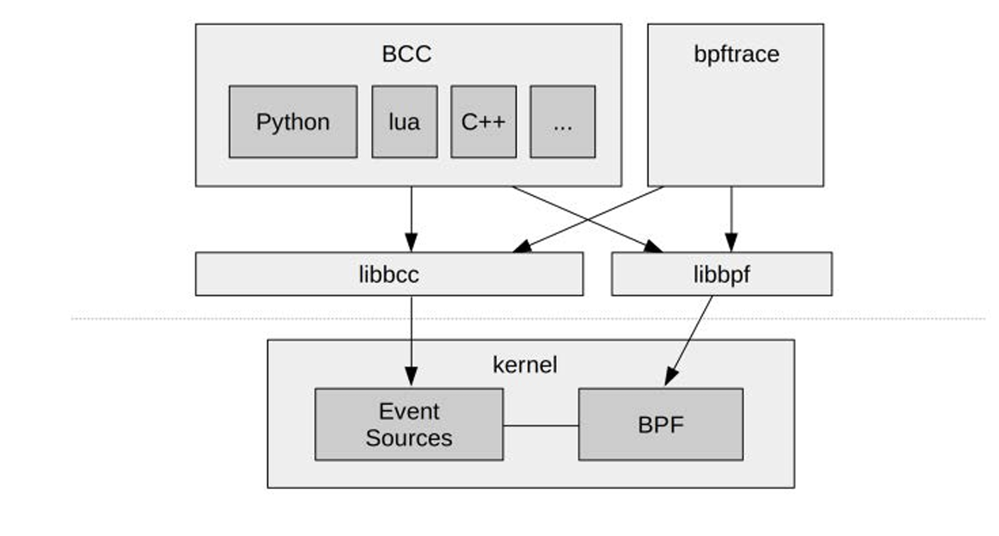
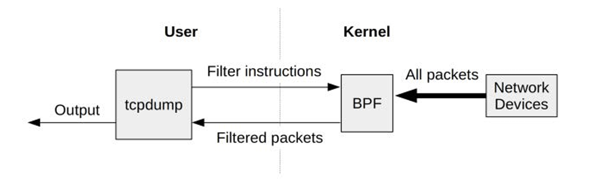
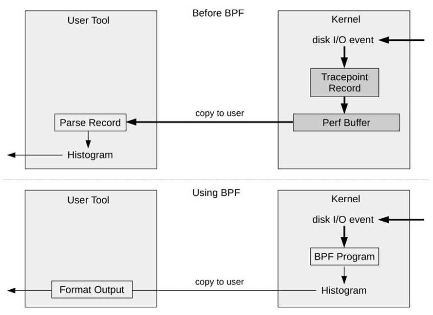
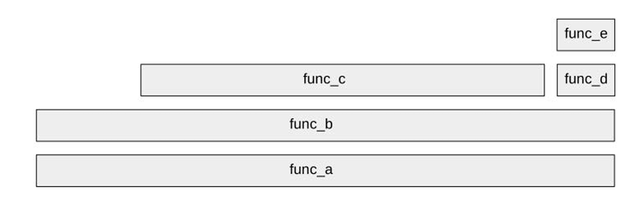

# Introduction

## What are BPF and eBPF ?

1. 傳統 BPF (Classic BPF)
    * **起源與目的：** BPF 最初於 1992 年開發，主要目的是為了提升像 `tcpdump` 這類網路封包擷取工具的效能。
    * **運作機制：** 使用者可以定義一個基於 BPF 虛擬機指令集的過濾表達式（位元糕，bytecode），將其傳入核心後由直譯器執行。這使得過濾動作可以直接在核心層級完成，避免將所有封包複製到使用者空間（user-space）進而帶來龐大的效能開銷。
    * **架構限制：** 傳統的 BPF 虛擬機器架構非常受限。它只有兩個 32 位元的暫存器（A 和 X）、一個僅包含 16 個記憶體插槽的暫存記憶體，以及一個程式計數器。

2. 擴展版 BPF (Extended BPF, 簡稱 eBPF)
    * **通用執行引擎：** 在 2013 到 2014 年間，Alexei Starovoitov 等人對 BPF 進行了重大重寫，將其轉變為一個「通用執行引擎」（General-purpose execution engine）。這使得核心變得完全可程式化（fully programmable），我們可以在各種系統與應用程式事件（如磁碟 I/O）上執行自訂的微型程式。
    * **架構升級：** 擴展版 BPF 將暫存器升級為 10 個 64 位元的暫存器（R0–R9），外加一個唯讀的框架指標（R10）。這樣的設計能與現代 64 位元處理器的原生硬體暫存器進行一對一映射，大幅優化了執行效率。
    * **資料結構與輔助函式：** 捨棄了原本極小的 16 個記憶體插槽，eBPF 引入了靈活且空間幾乎無限的「Map」儲存物件（可用作雜湊表或陣列），並允許程式呼叫受限制的核心輔助函式（Helper functions）。

3. 安全性與效能保障 (核心工程視角)
    在生產環境（Production）中，我們絕對不能容許因為執行觀測工具而導致系統崩潰（Kernel Panic），eBPF 透過以下機制解決這個問題：
    * **驗證器 (Verifier)：** 在任何 BPF 程式被執行前，都必須通過核心的驗證器檢查。驗證器會確保該程式是安全的、不會破壞核心記憶體，並且必須在有界限的時間內執行完畢（不允許無窮迴圈）。
    * **JIT 編譯器 (Just-In-Time Compiler)：** 通過驗證後，JIT 編譯器會將 BPF 虛擬指令直接轉換為原生機器碼（Native instructions）。這確保了工具在極高負載的環境下也能具備接近原生的執行效率。

4. 名稱的統一化 (Terminology)

    雖然社群中為了區別早期的實作，經常使用「eBPF」這個詞，但目前的官方縮寫其實已經回歸為單純的「BPF」（不加 e）。現今的 Linux 核心內部只保留了一個統一的 BPF 執行引擎，它能同時兼容並執行傳統版與擴展版的程式。

    總結來說，現在的「BPF」應被視為一個獨立的「技術專有名詞」，因為它的應用範圍已跨足效能分析、資安及進階網路控制，不再僅限於柏克萊（Berkeley）、封包（Packet）或過濾（Filter）的原始範疇。

## What Are Tracing, Snooping, Sampling, Profiling, and Observability? 

1. Observability (可觀測性)
    可觀測性是一個巨觀的分類術語，指的是**透過觀察來理解一個系統的內部狀態與行為**。
    * **涵蓋範圍**：它包含了追蹤 (Tracing) 工具、採樣 (Sampling) 工具以及基於固定統計計數器 (Fixed counters) 的工具。本書所探討的 BPF 工具皆屬於利用 BPF 進行程式化追蹤的可觀測性工具。
    * **工程界線**：可觀測性工具與「基準測試 (Benchmark) 工具」有著嚴格的本質區別。基準測試會透過施加負載來改變系統的狀態（進行實驗），而可觀測性工具的最高原則是在不改變、不干擾生產環境工作負載的前提下，被動地進行測量與觀察。

2. Tracing (追蹤) 與 Snooping (窺探)
    這兩個術語在實務上通常指涉同一件事，即**基於事件的紀錄 (Event-based recording)**。
    * **Tracing (追蹤)**：追蹤器的特點在於它能夠記錄原始事件及其詮釋資料 (Metadata)。例如 Linux 傳統的 `strace(1)` 就是一種特殊用途的追蹤工具，專門記錄系統呼叫。
        * **傳統的效能痛點**：記錄所有事件會產生極度龐大的資料量，傳統做法往往需要將這些資料轉出後再進行高成本的後處理 (Post-processing)。
        * **BPF 的顛覆性**：BPF 讓追蹤變得「可程式化 (Programmatic)」。我們可以在核心層級針對事件直接執行小型 BPF 程式，進行客製化的「即時 (On-the-fly)」統計摘要，從而徹底免除了昂貴的資料搬閱與後處理成本。
    * **Snooping (窺探/擷取)**：這是一個歷史淵源的術語。在早期的 Solaris 作業系統中，有一支類似 Linux `tcpdump(8)` 的網路封包擷取工具被命名為 `snoop(1M)`。後來，開發者（包含本書作者）在開發早期的事件追蹤工具時，延用了這個命名慣例，因而誕生了如 `execsnoop`、`opensnoop`、`biosnoop` 等工具。本質上，Snooping、Event dumping (事件傾印) 與 Tracing 指的都是相同等級的深度事件監控。

3. Sampling (採樣) 與 Profiling (剖析)
    這兩個術語也是一體兩面，指的是**透過擷取測量資料的「子集 (Subset)」來描繪目標系統的粗略輪廓**。
    * **運作機制**：採樣工具通常基於定時器運作。例如 BPF 工具 `profile(8)` 可以在所有 CPU 上，每 10 毫秒進行一次採樣（相當於每秒 100 次的頻率）並記錄當下正在執行的程式碼。
    * **優勢 (Low Overhead)**：在 SRE 與系統工程實務中，這是在極端高負載系統下找尋瓶頸的首選。因為它只測量龐大事件集中的極小部分，其效能開銷 (Overhead) 遠低於攔截每一個事件的 Tracing 工具。
    * **劣勢 (Coarse Picture)**：由於只抽取樣本，它只能提供一個粗略的系統視角，且極有可能會遺漏瞬時發生或罕見的異常事件 (Outliers)。

在進行系統排障時，我們通常會依據這幾種方法的特性交替使用。如果需要長時間監控或在未知瓶頸的高負載系統中尋找耗能大戶（如哪支函式吃掉最多 CPU），我們會優先使用開銷極低的 **Sampling / Profiling** 工具。當我們鎖定了特定的異常行為，需要精確知道每一個 I/O 的延遲或是檔案存取的參數時，我們就會切換到 **Tracing / Snooping** 工具，並利用 BPF 的即時運算能力來控制效能開銷，進行微觀的根因分析。

## What Are BCC, bpftrace, and IO Visor?

撰寫原生的 BPF 虛擬機器指令集是一件極度繁瑣且缺乏效率的工作，因此工程界發展出了提供高階語言抽象的前端工具，其中最核心的兩大追蹤框架便是 BCC 與 bpftrace。

1. BCC (BPF Compiler Collection)
    BCC 是社群中第一個為 BPF 開發的高階追蹤框架。它本質上是一個編譯器框架與多種函式庫的集合，專門用於建構與編譯 BPF 軟體。在系統架構上，BCC 提供了一個 C 語言的程式設計環境，讓工程師能撰寫在核心層級（kernel-level）執行的 BPF 程式碼，同時針對使用者層級（user-level）介面提供了 Python、Lua 以及 C++ 等語言的綁定（bindings）。

    在工程實務中，BCC 特別適合用於開發具有高複雜度、依賴外部函式庫整合，或需要作為常駐程式（daemon）長時間執行的系統分析工具。BCC 的官方儲存庫中更內建了超過 70 種隨插即用的 BPF 效能分析與除錯工具（例如 `execsnoop`、`opensnoop` 與 `biolatency` 等），讓 SRE 無需自行撰寫任何程式碼，即可直接在生產環境中進行深度的效能觀測與排障。

2. bpftrace
    bpftrace 是一個較新的前端追蹤器，其底層是直接建構在 BPF 技術以及 BCC 的函式庫（包含 libbcc 與 libbpf）之上。與 BCC 採用 Python/C++ 等通用語言不同，bpftrace 提供了一種專門為系統追蹤設計的高階程式語言，其語法設計靈感大量汲取自 awk 與 C 語言，以及早期的 DTrace 和 SystemTap。

    在底層實作上，bpftrace 的前端利用 lex 與 yacc 來解析其特有的程式語言，並使用 Clang 來解析 C 語言的資料結構（structs）；後端則將抽象語法樹轉換為 LLVM 中介表示法（IR），最終透過 LLVM 函式庫編譯成 BPF 位元糕（bytecode）寫入核心執行。bpftrace 語言的極度簡潔性，使其成為撰寫強大的一行程式碼（one-liners）與短型客製化腳本的最佳選擇。

在生產環境的排障策略上，BCC 與 bpftrace 是互補的技術組合，如下圖。BCC 的工具通常設計得較為複雜，內建了多種命令列選項與參數以應對不同的排障情境，這通常是我們解決問題的第一步。然而，若我們面臨極度特殊的效能瓶頸，現成的 BCC 工具無法提供足夠的能見度時，我們就會切換到 bpftrace。由於 bpftrace 的語言特性易於開發，工程師能在幾分鐘內針對特定的核心函式或應用程式邏輯寫出專屬的探測腳本。一旦這個 bpftrace 腳本的功能需求不斷增加，需要處理更複雜的控制邏輯或提供多樣的命令列參數時，我們最終可能會將該邏輯改寫，轉換回一個結構更嚴謹的 BCC 工具。



## BCC

`execsnoop` 會追蹤系統中所有的 `execve()` 系統呼叫。簡單來說，只要系統中有任何新的程式被執行（不論執行時間多短），它都會立刻抓到並顯示出來。這對於捕捉那些*一閃而過*的短暫程序（例如 Cron Job 或 Script 產生的子程序）非常有用。

```bash
$ sudo execsnoop-bpfcc
PCOMM            PID     PPID    RET ARGS
sh               142410  142409    0 /bin/sh -c command -v debian-sa1 > /dev/null && debian-sa1 1 1
debian-sa1       142411  142410    0 /usr/lib/sysstat/debian-sa1 1 1
sshd             142412  74506     0 /usr/sbin/sshd -D -R
sshd             142414  74506     0 /usr/sbin/sshd -D -R
sshd             142416  74506     0 /usr/sbin/sshd -D -R
sshd             142418  74506     0 /usr/sbin/sshd -D -R
sshd             142420  74506     0 /usr/sbin/sshd -D -R
sshd             142422  74506     0 /usr/sbin/sshd -D -R
sshd             142424  74506     0 /usr/sbin/sshd -D -R
sshd             142425  74506     0 /usr/sbin/sshd -D -R
9                142430  1         0 /proc/self/fd/9 --deserialize 39 --log-level info --log-target journal-or-kmsg
sa1              142430  1         0 /usr/lib/sysstat/sa1 1 1
sadc             142430  1         0 /usr/lib/sysstat/sadc -F -L -S DISK 1 1 /var/log/sysstat
sshd             142435  74506     0 /usr/sbin/sshd -D -R
sshd             142438  74506     0 /usr/sbin/sshd -D -R
sshd             142440  74506     0 /usr/sbin/sshd -D -R
sshd             142442  74506     0 /usr/sbin/sshd -D -R
sshd             142444  74506     0 /usr/sbin/sshd -D -R
sshd             142446  74506     0 /usr/sbin/sshd -D -R
sshd             142448  74506     0 /usr/sbin/sshd -D -R
sh               142453  142452    0 /bin/sh -c command -v debian-sa1 > /dev/null && debian-sa1 1 1
debian-sa1       142454  142453    0 /usr/lib/sysstat/debian-sa1 1 1
sshd             142455  74506     0 /usr/sbin/sshd -D -R
sshd             142458  74506     0 /usr/sbin/sshd -D -R
9                142460  1         0 /proc/self/fd/9 --deserialize 39 --log-level info --log-target journal-or-kmsg
sa1              142460  1         0 /usr/lib/sysstat/sa1 1 1
sadc             142460  1         0 /usr/lib/sysstat/sadc -F -L -S DISK 1 1 /var/log/sysstat
sshd             142464  74506     0 /usr/sbin/sshd -D -R
sshd             142467  74506     0 /usr/sbin/sshd -D -R
sh               142471  142470    0 /bin/sh -c command -v debian-sa1 > /dev/null && debian-sa1 1 1
debian-sa1       142472  142471    0 /usr/lib/sysstat/debian-sa1 1 1
sshd             142474  74506     0 /usr/sbin/sshd -D -R
sshd             142475  74506     0 /usr/sbin/sshd -D -R
sshd             142476  74506     0 /usr/sbin/sshd -D -R
sshd             142478  74506     0 /usr/sbin/sshd -D -R
sshd             142480  74506     0 /usr/sbin/sshd -D -R
sshd             142482  74506     0 /usr/sbin/sshd -D -R
sshd             142484  74506     0 /usr/sbin/sshd -D -R
sshd             142486  74506     0 /usr/sbin/sshd -D -R
9                142488  1         0 /proc/self/fd/9 --deserialize 39 --log-level info --log-target journal-or-kmsg
sa1              142488  1         0 /usr/lib/sysstat/sa1 1 1
sadc             142488  1         0 /usr/lib/sysstat/sadc -F -L -S DISK 1 1 /var/log/sysstat
sshd             142494  74506     0 /usr/sbin/sshd -D -R
sshd             142496  74506     0 /usr/sbin/sshd -D -R
sh               142499  142498    0 /bin/sh -c command -v debian-sa1 > /dev/null && debian-sa1 1 1
debian-sa1       142500  142499    0 /usr/lib/sysstat/debian-sa1 1 1
9                142501  1         0 /proc/self/fd/9 --deserialize 39 --log-level info --log-target journal-or-kmsg
fwupdmgr         142501  1         0 /usr/bin/fwupdmgr refresh
9                142507  1         0 /proc/self/fd/9 --deserialize 60 --log-level info --log-target journal-or-kmsg
fwupd            142507  1         0 /usr/libexec/fwupd/fwupd
...
```

從的輸出可以看到，系統當時正在頻繁執行以下活動：

* 大量的 SSH 活動 (sshd)：可以看到許多 PID 的父程序（PPID）都是 74506。這通常代表有人正在嘗試連線，或是 SSH 服務正在處理多個併發請求。

* 系統效能收集 (sysstat)：
  * 出現了 debian-sa1、sa1 與 sadc
  * 這是 Linux 常見的 sysstat 工具，正在執行定期的系統狀態採集（通常是每 10 分鐘一次，將數據寫入 /var/log/sysstat）

* 韌體更新檢查 (fwupdmgr)：
  * 最後幾行顯示 fwupdmgr refresh 正在運行，這是系統在檢查硬體韌體是否有可用的更新。

`biolatency` 用於統計*塊設備 I/O*（Block Device I/O，即磁碟讀寫）的耗時。它不會顯示具體哪個檔案在讀寫，而是以 直方圖 (Histogram) 的形式展現延遲的分佈狀況。

```bash
$ sudo biolatency-bpfcc -m
Tracing block device I/O... Hit Ctrl-C to end.
^C
     msecs               : count     distribution
         0 -> 1          : 1        |****************************************|
         2 -> 3          : 0        |                                        |
         4 -> 7          : 1        |****************************************|
         8 -> 15         : 1        |****************************************|

```

輸出來看，在追蹤的這段時間內，系統只發生了 3 次 磁碟 I/O 活動。

* 1 次在 0-1ms 之間（非常快）
* 1 次在 4-7ms 之間
* 1 次在 8-15ms 之間

目前磁碟幾乎沒有負載，非常清閒。

## BPF Tracing Visibility

BPF 追蹤的能見度（BPF Tracing Visibility）賦予了工程師看透整個軟體堆疊（Full Software Stack）的「X 光透視能力」，並且允許我們根據需求動態建立新的觀測工具與插樁點
。它的核心價值在於：可以直接在生產環境中即時啟用觀測，而完全無需重新開機或以任何特殊模式來重啟應用程式。

下圖為通用的系統軟體棧，BPF 工具能對應到特定的硬體或軟體框架。


## Dynamic Instrumentation: kprobes and uprobes

在面對高負載、高併發的生產環境排障時，動態插樁（Dynamic Instrumentation）是我們手中用來透視系統行為最強大的底層武器。它允許我們在不修改軟體原始碼、不重新編譯、且不需重啟服務的情況下，即時（live）將觀測探針插入到軟體堆疊的深處,。

以下是針對 BPF 追蹤技術中兩大動態插樁支柱，`Kprobes` 與 `Uprobes` 的核心機制：

1. 動態插樁的核心精神與底層機制
    * **零成本潛伏 (Zero Overhead)**：動態插樁最核心的系統設計哲學在於*未啟用時絕對零開銷。當探針處於未啟用狀態時，目標軟體會以完全未經修改的原生指令執行，這使得它能安全地部署於效能錙銖必較的生產環境中。
    * **斷點替換機制 (Breakpoint Replacement)**：在底層實作上，系統會備份目標記憶體位址的原始指令，並將其替換為架構原生的快速斷點指令（例如在 x86_64 架構上是 `int3`）。當 CPU 執行流程觸發該斷點時，會陷入核心並執行我們的 BPF 處理常式，完成後再執行被備份的原始指令並恢復正常流程。

    * **蹦床函數 (Trampoline)**：若要測量函式執行的完整延遲（Latency），我們需要攔截函式的返回點（即 `kretprobe` / `uretprobe`）。其機制是在進入函式時，動態將返回位址劫持並替換為一個「蹦床函數 (Trampoline)」。待目標函式執行完畢跳轉至該蹦床時，會觸發返回探針的 BPF 紀錄邏輯，隨後再安全地返回給真正的呼叫者,。

2. Kprobes：核心層級的動態插樁
  Kprobes 於 2004 年（Linux 2.6.9）被引入核心，賦予了我們觀測數以萬計核心內部函式與指令細節的能力。
  
3. Uprobes：使用者層級的動態插樁
  Uprobes 於 2012 年（Linux 3.5）正式合併至核心，讓我們能將透視能力延伸至應用程式與系統函式庫。

## Static Instrumentation: Tracepoints and USDT 

動態插樁（Dynamic Instrumentation，如 kprobes 和 uprobes）雖然賦予我們極大的觀測自由度，但在工程實務上面臨一個致命缺點:*介面穩定性問題（Interface stability issue*。當軟體版本升級時，函式可能會被重新命名或移除，進而導致 BPF 觀測工具突然失效。此外，編譯器的最佳化機制（如內聯，Inlining）也可能導致函式無法透過 kprobes 或 uprobes 進行插樁。

為了解決介面不穩定以及編譯器內聯的問題，在系統架構中引入了靜態插樁（Static Instrumentation）。靜態插樁是將穩定的事件名稱直接編碼（coded）寫入軟體中，並由軟體開發者負責長期維護。

在 BPF 追蹤體系中，靜態插樁主要分為兩大核心技術：

1. **Tracepoints（核心層級靜態插樁）：**
   這是專門用於作業系統核心（Kernel-level）的靜態插樁技術。核心開發者在程式碼中預先埋入這些追蹤點，為工程師提供穩定的 API。例如，若要追蹤 `open(2)` 系統呼叫，我們可以使用 bpftrace 探針 `tracepoint:syscalls:sys_enter_open`。

2. **USDT（使用者層級靜態追蹤）：**
   全名為 User-Level Statically Defined Tracing，是用於使用者層級（User-level）軟體的靜態插樁技術。它允許我們在應用程式內部定義觀測點。例如，若要監控 MySQL 資料庫的查詢起始狀態，可以使用探針 `usdt:/usr/sbin/mysqld:mysql:query__start`。

然而，系統設計上總是存在權衡（Trade-off）。靜態插樁最大的缺點在於，這些探針會成為開發人員的*維護負擔（Maintenance burden）*。因為每一個靜態探針都需要由開發者手動定義並確保其在後續版本中持續有效，所以系統中靜態插樁的數量通常十分有限。

以下這個工具在 BPF (eBPF) 領域中非常經典，主要用途是實時監控全系統中所有程序打開檔案 (open system call) 的行為。

```bash
$ sudo opensnoop.bt
Attaching 6 probes...
Tracing open syscalls... Hit Ctrl-C to end.
PID    COMM               FD ERR PATH
162987 sshd               10   0 /proc/self/oom_score_adj
162987 sshd                3   0 /etc/ld.so.cache
162987 sshd                3   0 /lib/x86_64-linux-gnu/libcrypt.so.1
162987 sshd                3   0 /lib/x86_64-linux-gnu/libwrap.so.0
162987 sshd                3   0 /lib/x86_64-linux-gnu/libaudit.so.1
162987 sshd                3   0 /lib/x86_64-linux-gnu/libpam.so.0
162987 sshd                3   0 /lib/x86_64-linux-gnu/libselinux.so.1
162987 sshd                3   0 /lib/x86_64-linux-gnu/libgssapi_krb5.so.2
162987 sshd                3   0 /lib/x86_64-linux-gnu/libkrb5.so.3
162987 sshd                3   0 /lib/x86_64-linux-gnu/libcom_err.so.2
162987 sshd                3   0 /lib/x86_64-linux-gnu/libcrypto.so.3
162987 sshd                3   0 /lib/x86_64-linux-gnu/libz.so.1
162987 sshd                3   0 /lib/x86_64-linux-gnu/libc.so.6
162987 sshd                3   0 /lib/x86_64-linux-gnu/libcap-ng.so.0
162987 sshd                3   0 /lib/x86_64-linux-gnu/libpcre2-8.so.0
162987 sshd                3   0 /lib/x86_64-linux-gnu/libk5crypto.so.3
162987 sshd                3   0 /lib/x86_64-linux-gnu/libkrb5support.so.0
162987 sshd                3   0 /lib/x86_64-linux-gnu/libkeyutils.so.1
162987 sshd                3   0 /lib/x86_64-linux-gnu/libresolv.so.2
162987 sshd                3   0 /proc/sys/kernel/cap_last_cap
162987 sshd                3   0 /proc/filesystems
162987 sshd                3   0 /dev/null
162987 sshd               -1   2 /proc/sys/crypto/fips_enabled
162987 sshd                3   0 /usr/lib/ssl/openssl.cnf
162987 sshd                4   0 /etc/gai.conf
162987 sshd                4   0 /etc/nsswitch.conf
162987 sshd                4   0 /etc/passwd
162987 sshd                4   0 /etc/ssh/ssh_host_rsa_key
162987 sshd                4   0 /etc/ssh/ssh_host_rsa_key
162987 sshd                4   0 /etc/ssh/ssh_host_rsa_key.pub
162987 sshd                4   0 /etc/ssh/ssh_host_ecdsa_key
162987 sshd                4   0 /etc/ssh/ssh_host_ecdsa_key
162987 sshd                4   0 /etc/ssh/ssh_host_ecdsa_key.pub
162987 sshd                4   0 /etc/ssh/ssh_host_ed25519_key
162987 sshd                4   0 /etc/ssh/ssh_host_ed25519_key
162987 sshd                4   0 /etc/ssh/ssh_host_ed25519_key.pub
162987 sshd               -1   6 /dev/tty
162987 sshd                5   0 /dev/null
162987 sshd                5   0 /etc/hosts.allow
162987 sshd                5   0 /etc/hosts.deny
162988 sshd                6   0 /etc/gss/mech.d
162987 sshd                5   0 /etc/passwd
162987 sshd                5   0 /etc/pam.d/sshd
162987 sshd                8   0 /etc/pam.d/common-auth
162987 sshd                9   0 /usr/lib/x86_64-linux-gnu/security/pam_unix.so
162987 sshd                9   0 /usr/lib/x86_64-linux-gnu/security/pam_deny.so
162987 sshd                9   0 /usr/lib/x86_64-linux-gnu/security/pam_permit.so
162987 sshd                9   0 /usr/lib/x86_64-linux-gnu/security/pam_cap.so
162987 sshd                9   0 /etc/ld.so.cache
162987 sshd                9   0 /lib/x86_64-linux-gnu/libcap.so.2
162987 sshd                8   0 /usr/lib/x86_64-linux-gnu/security/pam_nologin.so
162987 sshd                8   0 /etc/pam.d/common-account
162987 sshd                8   0 /usr/lib/x86_64-linux-gnu/security/pam_selinux.so
162987 sshd                8   0 /usr/lib/x86_64-linux-gnu/security/pam_loginuid.so
162987 sshd                8   0 /usr/lib/x86_64-linux-gnu/security/pam_keyinit.so
162987 sshd                8   0 /etc/pam.d/common-session
162987 sshd                9   0 /usr/lib/x86_64-linux-gnu/security/pam_umask.so
162987 sshd                9   0 /usr/lib/x86_64-linux-gnu/security/pam_systemd.so
162987 sshd                9   0 /etc/ld.so.cache
162987 sshd                9   0 /lib/x86_64-linux-gnu/libpam_misc.so.0
162987 sshd                9   0 /lib/x86_64-linux-gnu/libm.so.6
162987 sshd                8   0 /usr/lib/x86_64-linux-gnu/security/pam_motd.so
162987 sshd                8   0 /usr/lib/x86_64-linux-gnu/security/pam_mail.so
162987 sshd                8   0 /usr/lib/x86_64-linux-gnu/security/pam_limits.so
162987 sshd                8   0 /usr/lib/x86_64-linux-gnu/security/pam_env.so
162987 sshd                8   0 /etc/pam.d/common-password
162987 sshd                5   0 /etc/pam.d/other
162987 sshd                8   0 /etc/pam.d/common-auth
162987 sshd                8   0 /etc/pam.d/common-account
162987 sshd                8   0 /etc/pam.d/common-password
162987 sshd                8   0 /etc/pam.d/common-session
162987 sshd                5   0 /proc/sys/kernel/ngroups_max
162987 sshd                5   0 /etc/group
162987 sshd                5   0 /etc/ld.so.cache
162987 sshd                5   0 /lib/x86_64-linux-gnu/libnss_systemd.so.2
162987 sshd                5   0 /run/systemd/userdb/
162987 sshd                5   0 /
```

`opensnoop.bt` 的核心用途

1. 偵測遺失的檔案與配置錯誤

    觀察 **ERR** 欄位。如果看到非 0 的數值（例如 `-2` 代表 ENOENT），表示該程式試圖打開一個不存在的檔案。這對於排除為什麼我的程式抓不到設定檔非常有用。

    > 例如你的輸出中：`/proc/sys/crypto/fips_enabled` 回傳了 `-1` (ERR 2)，代表該系統未啟用 FIPS 模式，這在診斷加密行為時很有參考價值。

2. 安全審計 (Security Auditing)

    你可以監控誰在存取敏感路徑（如 `/etc/shadow`, `/etc/ssh/ssh_host_key`）。如果有一個不相關的 PID 試圖打開這些檔案，這就是入侵警告。

3. 分析程式啟動行為

    正如上述 `sshd` 輸出，你可以完整看到一個服務啟動或連線時，它背後到底摸過哪些檔案：
    * 載入了哪些**共享函式庫 (`.so`)**?
    * 讀取了哪些**認證模組 (PAM)**?
    * 使用了哪些**金鑰檔案**?

4. 效能優化與資源過載排查
    如果一個程式在短時間內反覆打開同一個檔案，可能代表該程式的快取機制失效，或是存在不必要的 I/O 損耗。

針對你當前 `sshd` 狀態的解析

上述記錄了一個SSH 使用者登入認證的完整過程。我們可以從路徑 (PATH) 的變化看出 `sshd` 的動作順序：

1. **環境初始化**：載入 `/etc/ld.so.cache` 與各種系統函式庫 (`libcrypt`, `libpam`, `libselinux` 等)。
2. **密鑰讀取**：打開 `/etc/ssh/ssh_host_rsa_key` 等主機金鑰，用於建立加密連線。
3. **身份驗證與權限控制**：
    * 存取 `/etc/passwd` 檢查用戶是否存在。
    * 讀取 `/etc/pam.d/sshd` 以及 `/usr/lib/.../security/pam_unix.so`，這代表它正在啟動 **PAM (Pluggable Authentication Modules)** 認證框架。
4. **環境設定**：存取 `/etc/motd` (登入後的歡迎訊息)、`/etc/group` 與系統限制設定。

# Technology Background


BPF 追蹤技術

## BPF

它的運作機制非常獨特且巧妙，終端使用者透過 BPF 虛擬機器的指令集（有時被稱為 BPF 字節碼，bytecode）來定義過濾表達式，接著將這些指令傳遞至作業系統核心，由核心中的直譯器（Interpreter）負責執行。這樣的設計允許封包過濾直接在核心層級進行，免除了將每個封包複製到使用者層級（User-level）行程的昂貴效能開銷，進而大幅提升了如 tcpdump 等封包擷取工具的效能表現。



在系統架構設計上，由於早期的封包過濾必須在核心空間（Kernel space）發生，因此安全性是一項極其嚴格的硬性要求。BPF 提供了這種安全性，因為來自使用者空間的過濾器在實際執行前，會先經過驗證機制確保其安全無虞。

## Extended BPF (eBPF)

1. 核心架構與演進：從 Classic BPF 到 Extended BPF

    Extended BPF 在架構上進行了大幅度的現代化升級，使其能與現代 64 位元處理器完美契合：
    * **硬體暫存器映射：** 將原本僅有 2 個 32 位元暫存器的架構，擴展為 10 個 64 位元暫存器（R0–R9），外加一個唯讀的框架指標（R10），這使得 BPF 指令能與原生硬體暫存器進行一對一映射，大幅優化執行效率。
    * **虛擬機安全與執行機制：** BPF 程式在載入核心前，必須經過**驗證器 (Verifier)** 的嚴格檢查。驗證器會阻擋任何可能導致記憶體損壞或無窮迴圈的危險程式碼，確保程式會在有界限的時間內執行完畢。通過驗證後，**JIT 編譯器**會將 BPF 字節碼 (Bytecode) 直接轉換為原生機器碼 (Native Instructions) 以全速執行。
    * **儲存機制的解放：** 捨棄了原本只有 16 個記憶體插槽的限制，引入了彈性且空間幾乎無限的「Map」鍵值對資料結構。

    

2. 效能觀測的顛覆性優勢 (Why Performance Tools Need BPF)
    在複雜的高負載系統中，傳統的追蹤工具（如將所有事件寫入 Perf Buffer 並複製到 User-space 進行解析）會帶來極高的 CPU 與 I/O 開銷。BPF 解決了這個痛點：
    * **核心內聚合 (In-kernel Aggregation)：** BPF 允許我們直接在核心層級針對事件（如每次 Disk I/O）執行自訂程式，抓取所需欄位（如位元組數），並即時將結果存入 BPF Map（如繪製直方圖）。
    * **極低開銷：** User-space 程式只需讀取最終的 Map 統計結果，完全免除了海量原始事件跨空間複製與後處理的昂貴成本。
    * **取代核心模組 (Kernel Modules)：** 相較於編寫傳統核心模組，BPF 有著 Verifier 保障系統不會 Panic、提供穩定的 ABI（編譯一次到處執行），並且無需依賴核心編譯產物，降低了開發與部署的風險。

    

    上圖，呈現了在進行系統觀測與產生直方圖（Histograms）時，引入 BPF 技術前後的核心架構與效能差異。最關鍵的突破在於，BPF 允許直接在**核心空間（Kernel Context）**完成資料的計算與直方圖生成，進而大幅減少需要傳輸至使用者空間（User Space）的資料量。

    **使用 BPF 之前（傳統作法）：**
    * **核心空間記錄所有事件**：每當磁碟 I/O 等事件發生時，Kernel 需要將包含許多不必要詮釋資料（metadata）的紀錄寫入 perf buffer 中。
    * **跨空間的大量資料複製**：系統必須週期性地將包含「所有原始事件」的龐大 buffer 完整複製到使用者空間。
    * **使用者空間進行解析與計算**：使用者程式必須逐一爬梳與解析這些事件，只為了提取單一目標欄位（例如 bytes），最後才在使用者空間計算並產生直方圖。
    * **效能痛點**：在 I/O 密集的系統下（例如每秒上萬次 I/O），這種頻繁的資料拷貝與事後解析會帶來極高的效能開銷（Overhead）。

    **使用 BPF 之後（現代作法）：**
    * **核心空間動態掛載與即時處理**：啟用事件觀測時，系統會直接將你編寫的 BPF 程式掛載到目標事件上。
    * **核心內直接完成統計**：事件發生時，BPF 程式會直接在 Kernel 中執行，僅精準提取需要的欄位，並直接存入自訂的 BPF Map 直方圖結構中進行累加。
    * **使用者空間僅需讀取最終結果**：User space 的工具只需要去讀取這個*已經在核心中統計好*的 BPF Map 直方圖並將其格式化印出即可。
    * **效能優勢**：徹底免除了將龐大原始事件與無用欄位複製到使用者空間的成本，並省去重複處理的時間，讓這類高效能分析工具得以在正式環境（Production）中安全且極低負擔地運行。

3. 開發工具鏈與檢視機制
    通常不會直接撰寫 BPF 字節碼，而是透過高階前端工具進行開發：
    * **開發前端：** 可使用 Clang/LLVM 將 C 語言編譯為 BPF 標的，或是使用更友善的 BCC 框架（C 與 Python/C++ 結合）以及 bpftrace（專用高階腳本語言）。
    * **底層檢視：** Linux 提供了 `bpftool` 工具，可以讓工程師檢視目前掛載的 BPF 程式、Maps，甚至可以 Dump 出 JIT 編譯過後的真實處理器組合語言指令（透過 `bpftool prog dump jited`），方便進行極限效能除錯。

4. 關鍵 API 與 Concurrency (併發) 控制
    BPF 程式受到嚴格限制，無法隨意呼叫核心函數，必須依賴系統提供的 **Helper Functions** 與特定機制：
    * **核心輔助函數 (Helper Functions)：** 提供安全存取系統狀態的介面，例如 `bpf_ktime_get_ns()` 用於獲取高精度時間戳，以及至關重要的 `bpf_probe_read()`，能在關閉分頁錯誤 (Page Faults) 的安全前提下，讀取任意核心記憶體。
    * **Syscall 與程式類型：** User-space 透過 `bpf(2)` 系統呼叫來操作 BPF。下表是部分 syscall Commands

    |bpf_cmd|Description|
    |---|---|
    |BPF_MAP_CREATE | Creates a BPF map: a flexible storage object that can be used as a key/value hash table (associative array).|
    |BPF_MAP_LOOKUP_ELEM|Looks up an element via a key.|
    |BPF_MAP_UPDATE_ELEM|Updates an element, given a key.|
    |BPF_MAP_DELETE_ELEM|Deletes an element, given a key.|
    |BPF_MAP_GET_NEXT_KEY|Iterates over all keys in a map.|
    |BPF_PROG_LOAD|Verifies and loads a BPF program.|
    |BPF_PROG_ATTACH|Attaches a BPF program to an event.|
    |BPF_PROG_DETACH|Detaches a BPF program from an event.|
    |BPF_OBJ_PIN|Creates a BPF object instance in /sys/fs/bpf.|

    * **併發控制 (Concurrency Controls)：** 在多核心環境下，多個執行緒可能同時觸發 BPF 程式並更新 Map，導致「遺失更新」(Lost Update) 的 Race Condition 競爭問題。實務上常使用 **Per-CPU Maps** (如 `BPF_MAP_TYPE_PERCPU_HASH`) 來讓每個 CPU 獨立計數以避開鎖競爭，或者使用專屬的原子操作指令 (`BPF_XADD`)，以及在 Linux 5.1 引入的 `bpf_spin_lock()` 進行同步控制。

5. 進階工程特性：BTF 與 CO-RE

    為了解決跨核心版本維護工具的困難，社群推出了兩項極具潛力的技術：

    * **BTF (BPF Type Format)：** 類似於極度輕量化的 Debuginfo。它將核心資料結構 (Structs)、程式與 Map 的元資料編碼，不僅能讓 `bpftool` 完美還原帶有 C 原始碼的除錯訊息，更使未來的 vmlinux 具備自我描述的能力。
    * **CO-RE (Compile Once - Run Everywhere)：** SRE 在部署觀測工具時，常為了目標機器的核心標頭檔不一致而困擾。CO-RE 結合 BTF 資訊，讓 BPF 程式在編譯後，能在執行期動態修正 Struct 的記憶體偏移量 (Offsets)，這意味著我們可以將編譯好的 BPF 執行檔直接派發到不同核心版本的機器上完美運行，大幅降低環境依賴。

6. BPF 系統限制與實務考量
    在設計 BPF 演算法與架構時，需注意以下硬性限制：
    * **堆疊大小受限：** BPF 的堆疊空間被嚴格限制在 512 Bytes (`MAX_BPF_STACK`)。如果需要儲存較大的字串或結構體，必須改用 BPF Map 來當作儲存空間。
    * **指令與迴圈限制：** 早期指令數上限為 4096 條，但在 Linux 5.2 大幅放寬至 100 萬條；另外，在 Linux 5.3 才開始支援具備可驗證上限的「有界迴圈」(Bounded Loops)，過去則必須依賴編譯器將迴圈展開 (Unrolling)。

## Stack Trace Walking

在進行系統觀測與效能剖析時，追蹤堆疊走訪（Stack Trace Walking）是釐清事件觸發路徑（Code Path）與 CPU 消耗瓶頸的核心技術。BPF 提供了專屬的 Map 型別來記錄這些 Stack traces，並依靠不同的技術來走訪記憶體堆疊。

1. 基礎指標走訪 (Frame Pointer-Based Stacks)
    這是目前 BPF 環境中最常見、也最依賴的 Stack walking 方式。
    * **運作原理：** 根據標準呼叫慣例，一個 Linked list 的頭部會儲存在特定的暫存器中（x86_64 架構上為 `RBP`），而返回位址（Return address）固定存在與 RBP 偏移量為 +8 的位置。這使得追蹤工具或除錯器能夠極其高效地沿著 RBP 指標鏈，還原出完整的 Call stack。
    

    * **實務痛點與解法：** 現代的 `gcc` 編譯器預設會省略 Frame pointer（`-fomit-frame-pointer`），把 RBP 當作一般通用暫存器使用以極小化暫存器壓力，但這會直接破壞 BPF 工具解析 Call stack 的能力。在擁有 16 個通用暫存器的 x86_64 架構下，省略 Frame pointer 帶來的效能提升往往不到 1%，微乎其微。
    * **案例：** 在生產環境中，強烈建議在編譯軟體時加上 `-fno-omit-frame-pointer` 參數強制保留它。例如 Netflix 就選擇將微服務的 Frame pointer 重新啟用，因為精準的 CPU Profiling 所帶來的架構優化與除錯效益，遠大於極微小的效能損耗。

2. 偵錯資訊 (debuginfo / DWARF)
    當軟體沒有 Frame pointer 時，除錯器會仰賴此機制。
    * **運作原理：** 軟體可透過獨立的 debuginfo 套件提供 ELF 格式的 DWARF 資訊（包含 `.eh_frame` 與 `.debug_frame` 區段），用來推算函數的堆疊佈局。
    * **BPF 支援限制：** 這些 debuginfo 檔案體積極為龐大（例如 17 MB 的動態庫對應的 debuginfo 可能高達 222 MB）。因為解析 DWARF 結構非常消耗 CPU 運算資源，且可能產生 Page fault，這在 BPF 所屬的中斷禁用（Interrupt-disabled）嚴苛核心環境下是難以實作的。因此，**BPF 目前並不支援**使用 DWARF 進行 Stack walking。不過 BCC 或 bpftrace 等 User-space 工具，仍然會載入它來進行符號名稱（Symbols）的解析。

3. 最後分支紀錄 (Last Branch Record, LBR)
    * **運作原理：** LBR 是一項 Intel 處理器的硬體功能，能夠在硬體緩衝區中記錄最近的分支跳轉（包含函式呼叫），藉此重建 Stack trace。
    * **特性：** 具有**零效能開銷 (Zero overhead)** 的優勢，但缺點是追蹤深度受限於處理器硬體限制，通常只能追蹤 4 到 32 層的分支。對於動輒幾十層 Call stack 的現代企業級應用（例如 Java）往往不敷使用。目前 BPF 尚不支援 LBR，但未來有機會加入以作為深度受限的備用方案。

4. ORC (Oops Rewind Capability)
    * **運作原理：** ORC 是一種較新的除錯資訊格式，專門為 Stack traces 的展開而設計，且運算開銷遠低於 DWARF。它透過 ELF 檔案中的 `.orc_unwind` 區段來運作。
    * **支援度：** 目前 ORC 主要在 Linux 核心中實作。BPF 已經能透過底層的 `perf_callchain_kernel()` 來支援 ORC 格式的 Kernel stack traces。這允許核心本身在編譯時省略 Frame pointer 卻依然能被高效分析，不過此技術尚未擴展至 User-space 應用程式的 Stack 追蹤。

5. 符號解析與風險 (Symbols)
    在核心深處，BPF 記錄的 Stack trace 實際上只是「記憶體位址的陣列」，並不知道具體的函數名稱。這些位址陣列必須傳遞給 User-space 工具進行事後解析，將位址轉換為人類可讀的符號（Symbols）。
    * **工程風險：** 如果在 BPF 收集到位址陣列，到 User-space 進行符號翻譯的這段時間差之內，目標軟體的記憶體分佈或 Symbol map 發生了改變（這在 JIT 編譯器如 JVM 或 Node.js 的運作中非常常見），就會導致符號翻譯失敗或結果無效。未來有計畫直接將符號解析的步驟實作於 Kernel space 以避免此落差。

## Flame Graphs

在效能剖析與系統除錯的實務中，當我們使用 `perf` 或 BPF 工具（如 `profile`）進行系統取樣時，往往會產生數以千計、長達數百頁的堆疊追蹤（Stack Traces）文字輸出，這使得人工判讀與找出效能瓶頸變得極度困難。為了解決這個痛點，Brendan Gregg 發明了火焰圖（Flame Graphs），這是一種專為視覺化大量堆疊追蹤而設計的高效分析工具。

1. 火焰圖的視覺化核心原理
    火焰圖本質上是一種具有顛倒冰柱佈局（Inverted icicle layout）的相鄰圖，用來呈現堆疊追蹤的層次結構。
    * **方塊代表的意義 (Stack Frame)：** 圖中的每一個方塊（Box）都代表堆疊中的一個函式（Stack Frame）。
    * **Y 軸 (Stack Depth)：** 代表堆疊的深度。由下而上分別是函式的呼叫關係，最底部（Root）是程式的起點，最頂部（Leaf）則是當前正在執行的函式。由下往上看可理解程式的執行流程，由上往下看則能追溯函式的祖先（呼叫來源）。最頂部的邊緣即代表了正在 CPU 上執行的函式（On-CPU）。
    * **X 軸 (Sample Population)：** 這是初學者最常誤解的地方。**火焰圖的 X 軸絕對不代表時間的流逝**，而是整個取樣母體的總和。在 X 軸上的函式排列是經過英文字母排序的，這樣做是為了將相同的函式最大化地合併在一起。方塊的寬度反映了該函式在所有樣本中出現的頻率（佔比），越寬的方塊代表它在剖析資料中出現的次數越多、消耗的資源越大。

    

2. 系統分析實務：如何閱讀火焰圖
    * **尋找最寬的「塔 (Towers)」：** 閱讀火焰圖的訣竅是優先尋找圖中最寬的區塊並優先理解它們。
    * **忽略極窄的方塊：** 對於樣本數極少的冷門程式路徑，方塊會窄到無法顯示函式名稱。這其實是火焰圖在 UX 上的優點，它能利用視覺特性自然引導工程師將注意力集中在那些寬度足夠、附有清晰函式名稱的重大效能瓶頸上。

3. 進階互動性與顏色特徵
    原始的火焰圖軟體會生成帶有內嵌 JavaScript 的 SVG 檔案，提供強大的網頁互動體驗：
    * **顏色編碼 (Color Palettes)：**
        * **色相 (Hue)：** 預設雖以暖色系為主，但可依「程式碼類型」著色。例如：紅色代表使用者空間（User-level）原生程式碼、橘色為核心空間（Kernel-level）原生程式碼、黃色為 C++、綠色為直譯器函式（Interpreted）、水藍色為行內函式（Inlined）。
        * **飽和度 (Saturation)：** 根據函式名稱進行雜湊（Hash）產生，使相鄰的塔有隨機的顏色差異以便區別，同時確保同名函式在多張不同圖表中的顏色保持一致。
        * **背景色 (Background)：** 提供分析類型的視覺提示。黃色通常代表 CPU 火焰圖、藍色代表 Off-CPU（等待/阻塞）火焰圖、綠色則代表記憶體（Memory）火焰圖。若是呈現 IPC（每週期指令數）的火焰圖，則會採用藍色到白色再到紅色的漸層來表示。
    * **滑鼠懸停與放大 (Mouse-Overs & Zoom)：** 游標移至方塊上會顯示該函式在整體樣本中的精確百分比；點擊方塊則可水平放大，以便查看原本過窄的次級函式名稱。
    * **搜尋 (Search)：** 按下 Ctrl-F 可輸入搜尋字串，符合的方塊會以洋紅色（Magenta）醒目提示，並在畫面顯示包含該字串的堆疊佔整體比例。這對於快速計算系統有多少比例消耗在特定模組（如 `tcp_` 相關的核心網路程式碼）極為方便。

4. 火焰圖的延伸變體 (Variations)
    隨著觀測需求多樣化，火焰圖也衍生出不同的變體：
    * **冰柱圖 (Icicle Graph)：** 將 Y 軸順序反轉，根節點放在最上方。這在採用「由葉節點往根節點 (Leaf-to-root)」合併的場景中特別有用。例如分析 Spin locks 時，先合併相同的底層鎖函式，再往上看出是哪些不同的上層路徑呼叫了它。
    * **火焰圖表 (Flame Charts)：** 外觀類似，但 **X 軸確實代表時間的流逝**，而非字母排序。這種變體通常用於 Web 瀏覽器的 JavaScript 效能分析，適合觀察單執行緒應用程式中隨時間變化的執行模式。
    * **差異火焰圖 (Differential Flame Graphs)：** 專門用來視覺化並比較「兩份」剖析資料（例如改版前後、或正常與異常狀態）之間的差異。

## Event Sources


這些事件源解釋會在下面的內容

# Performance Analysis 


# BCC


# bpftrace