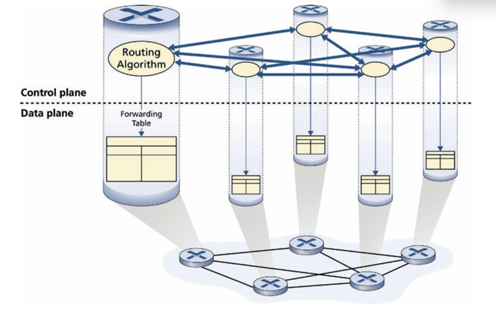
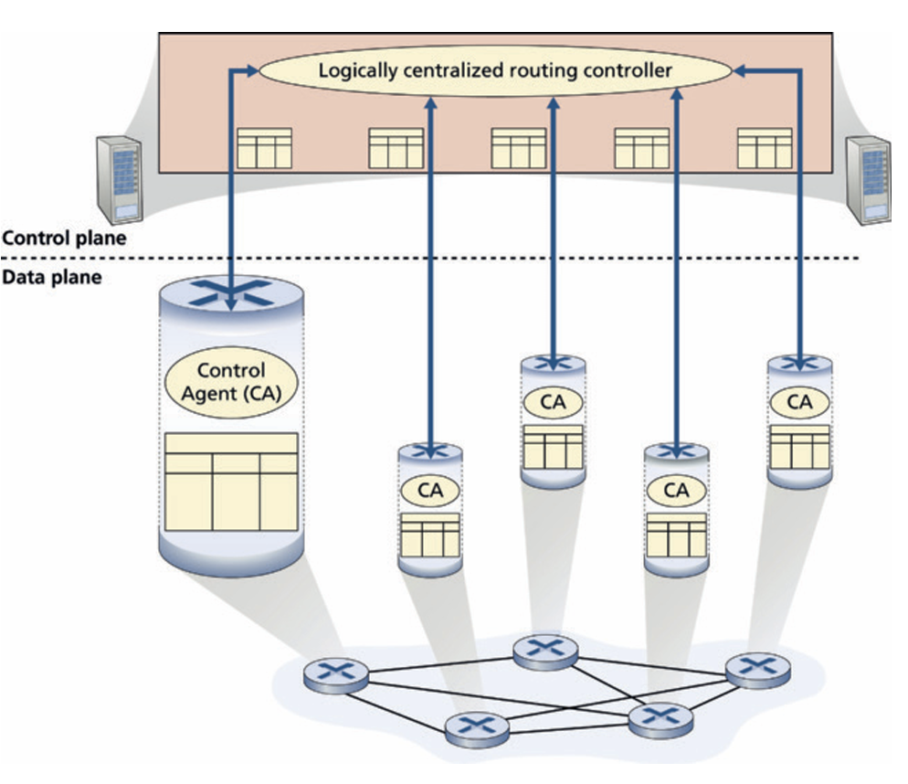
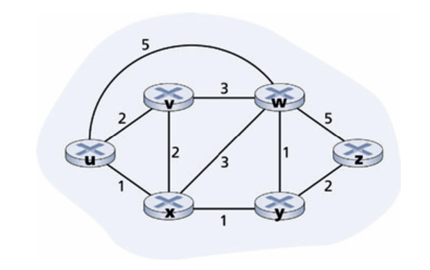
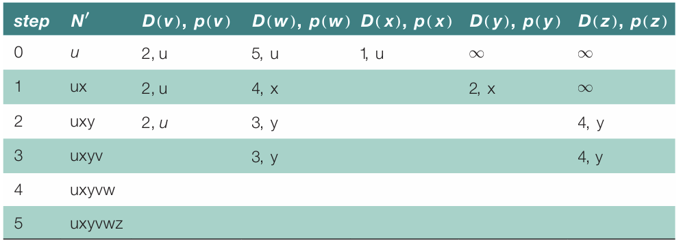
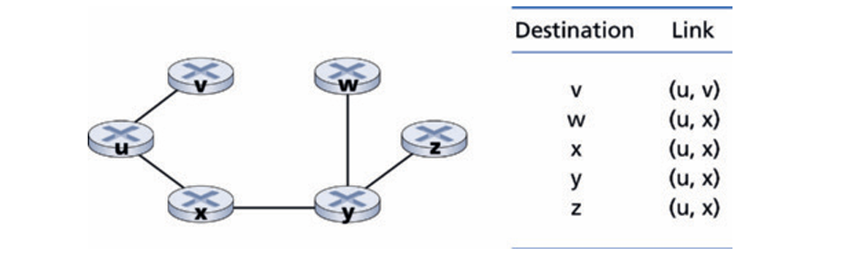
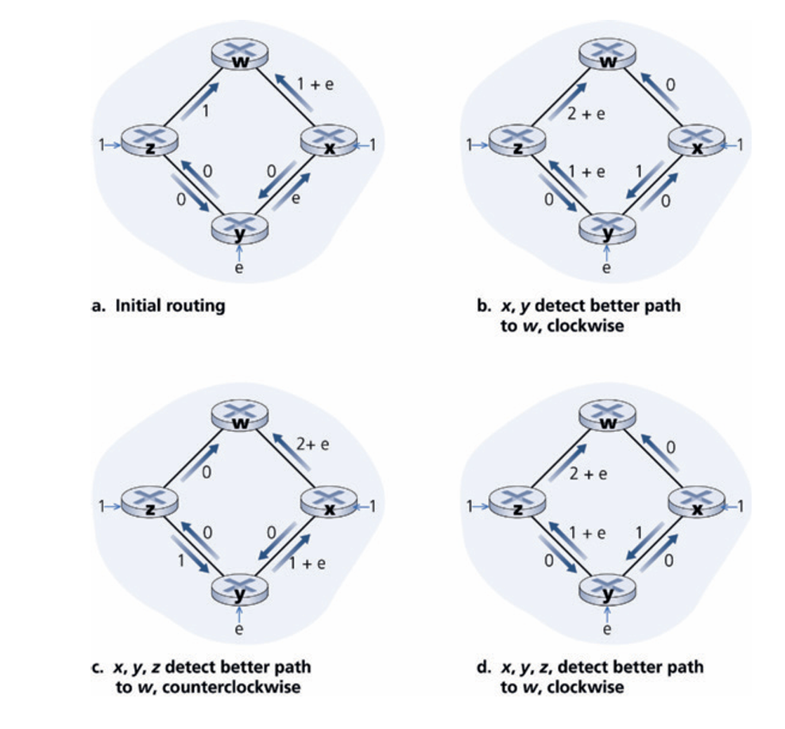
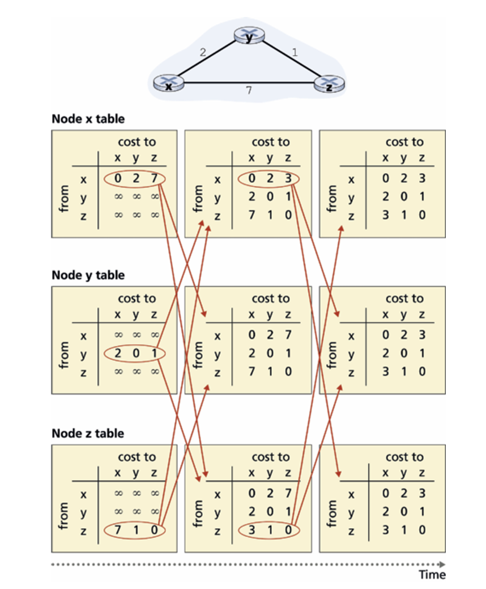
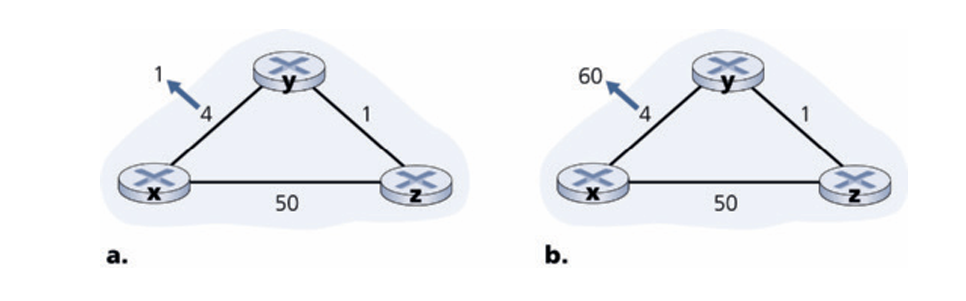

# The Network Layer: Control Plan

## Introduction

* 控制平面（Control Plane）的核心任務：負責計算、維護並安裝轉發表（Forwarding Table）與流表（Flow Table），進而主導資料平面（Data Plane）的封包轉發與處理行為
* 兩種控制平面實作方式
    * 逐路由器控制（Per-router Control，傳統分散式）
        * 每一台路由器內部同時具備轉發（資料平面）與路由演算法組件（控制平面）
        * 各路由器的路由組件透過通訊協定（如 OSPF、BGP）彼此直接通訊交換資訊，各自獨立計算並填入本地的轉發表
    * 邏輯集中式控制（Logically Centralized Control，SDN 架構）
        * 由一個*邏輯集中式控制器（Remote Controller）*統籌計算全網的轉發表/流表，並統一下發至各個路由器
        * 路由器內部僅需運行極簡的控制代理（Control Agent, CA），負責與控制器通訊並執行指示，CA 之間不互相通訊，也不參與轉發表的計算

* 邏輯集中的實務架構：從使用與管理角度看是一個單一中心服務點，但實務底層通常由多台伺服器組成叢集來實現，以滿足容錯（Fault-tolerance）與高擴展性（Scalability）需求

* 控制平面（上方）：每台路由器頂端都有一個獨立運行的 Routing Algorithm（路由演算法） 組件，各組件之間以多條水平箭頭相互連接交換訊息。
* 資料平面（下方）：路由演算法將計算出的路徑寫入本地的 Forwarding Table 中，供底層硬體依此轉發封包。

* 控制平面（上方）：由單一的 Logically centralized routing controller 作為中央大腦統籌所有路由計算。
* 控制代理（CA）與下發：各路由器內部僅保留輕量級的 Control Agent (CA)。控制器透過垂直控制通道與每個 CA 互動，將計算好的流表直接寫入底層設備，CA 之間並無橫向通訊。

## Routing Algorithms

* 系統建模與圖論抽象化：
    * 在網路控制平面的系統設計中，我們將整個網路拓撲抽象化為一個無向圖 $G = (N, E)$，其中 $N$ 代表節點（即執行轉發決策的實體路由器），$E$ 代表邊（即連接路由器的物理鏈路）。
    * 每一條鏈路都有其對應的核心度量值——鏈路成本 $c(x, y)$。這個數值在架構設計上可代表鏈路的物理長度、傳輸速率（鏈路頻寬）或維運資金成本。
    * 最優路徑決策（Least-Cost Path）： 路由演算法的終極任務，就是在一組給定的節點與鏈路成本中，找出端到端累積路徑成本（各段邊成本之和）最低的傳輸路徑。
* 三大演算法分類維度：
    * 全網全局型（Centralized / Link-State） vs. 局部邊緣分散型（Decentralized / Distance-Vector）：
        * Link-State (LS) 演算法：要求每個節點在運算前，都必須透過鏈路狀態廣播（Link-State Broadcast）獲取完整的全網拓撲與鏈路成本資訊。經典代表為 Dijkstra 演算法。
        * Distance-Vector (DV) 演算法：採迭代、分散式且非同步的運算架構。節點僅需知道與其直連鄰居的鏈路成本，並透過鄰居間反覆交換「距離向量（Distance Vector）」來收斂出全網最優路徑。經典代表為基於 Bellman-Ford 方程式的運算。
    * 靜態（Static） vs. 動態（Dynamic）：
        * 靜態路由改變極慢，通常需仰賴管理員手動調整鏈路成本。
        * 動態路由能對網路流量負載或拓撲變更做出即時自適應調整，但代價是容易引發路由迴圈（Routing loops）與路由震盪（Route oscillation）。
    * 負載敏感型（Load-Sensitive） vs. 負載無感型（Load-Insensitive）：
        * 負載敏感型演算法中，鏈路成本會動態反映當前的壅塞或延遲程度。早期的 ARPAnet 曾採用此設計，但實務上因易引發嚴重的系統不穩定而棄用。
        * 當今網際網路主流協定（如 OSPF、RIP、BGP）皆為負載無感型，鏈路成本不隨即時壅塞情況改變。

### The Link-State (LS) Routing Algorithm

1. LS 演算法的核心機制與全網視角 (Global View)
    * **全局資訊輸入：** LS 演算法的核心特徵是*在運算前，必須已知全網的拓撲結構與所有鏈路的成本*。
    * **鏈路狀態廣播 (Link-State Broadcast)：** 在實務部署中，全網視角是透過各個路由器節點向全網廣播*鏈路狀態封包*來達成的。每個封包詳細記載該節點與其直連鄰居的識別資訊及鏈路成本。
    * **一致的拓撲地圖：** 廣播漫延的結果使網域內的**每一台路   由器都擁有一份完全相同且完整的網路地圖**。各點隨後在本地端運行 LS 演算法，即可計算出一致的最少成本路徑。

2. 戴克斯特拉 (Dijkstra) 演算法與狀態變數
    * **單源最短路徑計算：** 網路界最著名的 LS 演算法為 **Dijkstra 演算法**，用於計算單一源節點 $u$ 到網路中所有其他節點的最少成本路徑。
    * **迭代收斂特性：** 此演算法採迭代方式運行。在第 $k$ 次迭代後，系統能精確確定到 $k$ 個目的地節點的最少成本路徑；且這 $k$ 條路徑，必然是所有端到端路徑中累積成本最小的前 $k$ 個。
    * **核心狀態變數定義**：
        * **$D(v)$**：在當前演算法迭代步驟中，從源節點 $u$ 到目的地 $v$ 的最少成本路徑估算值。
        * **$p(v)$**：源節點到 $v$ 的當前最少成本路徑上，緊鄰 $v$ 的前一個節點（即前驅鄰居節點）。
        * **$N'$**：節點的子集合。若節點 $v$ 已被納入 $N'$，代表從源節點到 $v$ 的確切最少成本路徑已 definitive 確定。
3. 演算法步驟與邏輯拆解 (Dijkstra's Algorithm Process)
    * 演算法包含一個「初始化步驟」與「循環步驟」，循環次數等於網路中的節點總數：
        * **初始化階段 (Initialization)：**
            * 將已確定集合 $N'$ 初始化為僅包含源節點自己：$N' = \{u\}$。
            * 對於所有其他節點 $v$：若 $v$ 是 $u$ 的直連鄰居，則將 $D(v)$ 設為其直接鏈路成本 $c(u,v)$；若非直連鄰居，則初始化為 $\infty$。
        * **循環運算階段 (Loop)：**
            * 在所有不在 $N'$ 中的節點裡，找出目前估算成本 $D(w)$ 最小的節點 $w$。
            * 將該節點 $w$ 加入確定集合 $N'$。
            * **更新鄰居成本：** 針對 $w$ 的所有不在 $N'$ 中的直連鄰居 $v$，更新其路徑估算值：
                $D(v) = \min(D(v), D(w) + c(w,v))$
        這行數學式的邏輯是：到達 $v$ 的新最少成本，要嘛是維持原先已知的成本 $D(v)$，要嘛是經由剛確定的 $w$ 再跨越一跳到 $v$ 的累積成本 ($D(w) + c(w,v)$)，兩者取其小。
    * 重複上述循環，直到所有節點皆被納入 $N'$ 為止（即 $N' = N$）。

4. 計算複雜度與系統效能數據證明 (Computational Complexity)
    * **【計算數據證明一： worst-case 時間複雜度】**
        * 假設網路中共有 $n$ 個節點（不含源節點）。
        * 在第 1 次迭代中，必須搜尋全部 $n$ 個節點以找出 $D(w)$ 最小者。
        * 在第 2 次迭代中，需搜尋剩下的 $n-1$ 個節點；第 3 次需搜尋 $n-2$ 個，依此類推。
        * 總檢索節點的次數為等差級數：$n + (n-1) + (n-2) + \dots + 1 = \frac{n(n+1)}{2}$
        * 因此，此標準實作在最壞情況下的時間複雜度為 $O(n^2)$。
    * **優化效能證明：Heap 堆積優化**
        * 在系統實作上，若改用 **堆積 (Heap)** 這種進階資料結構來儲存未定節點，能使「尋找最小值 (Line 9)」的步驟由線性時間（Linear time）巨幅縮減為對數時間（Logarithmic time），從而大幅優化整體系統複雜度。

上圖，繪製了一個由 $(u, v, w, x, y, z)$ 六個節點（路由器）構成的無向網格拓撲。每條鏈路旁皆用數字標明了雙向對稱的物理鏈路成本（例如 $c(u,x)=1, c(x,y)=1, c(y,z)=2$，而非鄰居節點如 $u$ 到 $z$ 則無直連線路，初始成本視為 $\infty$）。

狀態轉移表，展示了以 $u$ 為源節點運行 Dijkstra 演算法時，從 Step 0（初始化）到 Step 5 的狀態收斂軌跡。
    * 例如：在 Step 1 時，演算法選擇了目前成本最低（1）的節點 $x$ 加入 $N'$，並立刻將目的地 $w$ 的前驅節點更新為 $x$，使 $D(w)$ 的估計值由原本一跳的 5 降低為經由 $x$ 的 4（$D(w)=4, p(w)=x$），展示了系統如何透過迭代逐步逼近全局最優解。

 * **左側最短路徑樹**：以視覺化粗線繪製出從 $(u)$ 到達所有其他節點的端到端最少成本路徑（例如到 $(z)$ 的最短路徑為 $(u \to x \to y \to z)$，總成本為 4）。
 * **右側本地轉發表 (Forwarding Table)**：展示了如何將運算結果直接轉譯為控制平面的轉發表。轉發表僅需保留「目的地」到「下一跳輸出介面」的映射關係：
     * 目的地 $(v) \rightarrow$ 輸出介面 $((u,v))$
     * 目的地 $(w) \rightarrow$ 輸出介面 $((u,x))$ （經由最少成本路徑）
     * 目的地 $(x) \rightarrow$ 輸出介面 $((u,x))$
     * 目的地 $(y) \rightarrow$ 輸出介面 $((u,x))$
     * 目的地 $(z) \rightarrow$ 輸出介面 $((u,x))$
     * 目的地 $(z) \rightarrow$ 輸出介面 $((u,x))$

上圖，繪製了一個環狀拓撲，展示當鏈路的成本指標與其即時流量負載（或延遲）掛鉤時，系統會產生的病態震盪現象。
    * 上圖包含 (a)、(b)、(c)、(d) 四個連續時間狀態。一開始流量全走逆時針；當 LS 偵測到逆時針擁塞（成本高）而順時針空閒（成本低）時，在下一輪運行中，所有路由器會「自同步」地將流量全部切換至順時針，導致順時針瞬間暴堵；隨後又在下一輪同時切回逆時針，流量在順時針與逆時針之間像鐘擺一樣無休止地同步交替震盪，嚴重破壞網路頻寬穩定性。

### The Distance-Vector (DV) Routing Algorithm
在控制平面的系統設計中，距離向量 (Distance-Vector, DV) 路由演算法是一種經典的**去中心化**分散式運算架構
。與需要全局地圖的 LS 演算法不同，DV 演算法的核心在於**「局部資訊交換、鄰居間相互回饋、自我迭代收斂」**。

1. 演算法的核心三大特性 (System Characteristics)
    DV 演算法在設計上具備以下三個關鍵維度:
    * 分散式 (Distributed)：每個節點無需知道全網的完整拓撲與鏈路成本。節點初始時僅知道與其直接相連（第一跳）的鄰居鏈路成本，隨後透過與鄰居持續交換資訊來逐步拼湊出到達目的地的最省路徑。
    * 非同步式 (Asynchronous)：不要求網域內所有路由器步調一致地「同步」運算。每台路由器可依據本地事件（如鏈路成本變更或接收到鄰居的新宣告）獨立、非同步地啟動計算。
    * 疊代式與自我終止 (Iterative & Self-Terminating)：節點間會不斷互傳距離向量，重算並再次發送，此過程持續循環，直到沒有任何鄰居之間有新的資訊需要交換時，演算法會自然進入靜止狀態 (Quiescent state)，無須任何中央指令來宣告終止。

2. 數學基石：貝爾曼-福特方程式 (Bellman-Ford Equation)
    DV 演算法的控制邏輯與動態規劃 (Dynamic Programming) 計算完全奠基於 Bellman-Ford 方程式
    $$d_x(y) = \min_v \{ c(x,v) + d_v(y) \}$$
    其中：
        * $d_x(y)$：從源節點 $x$ 到目的地 $y$ 的實際最少路徑成本
        * $\min_v$：對節點 $x$ 的所有直連鄰居 $v$ 進行取極小值運算
        * $c(x,v)$：從節點 $x$ 跨越第一跳到鄰居 $v$ 的直接鏈路成本
        * $d_v(y)$：鄰居 $v$ 到目的地 $y$ 的最少累積路徑成本
    * 轉發表 (Forwarding Table) 的轉譯
        * 這個方程式在控制平面具有極高實用價值。若某個鄰居 $v^*$ 能夠讓該方程式取得最小值，則 $v^*$ 即被路由器判定為到達目的地 $y$ 的下一跳 (Next-hop) 轉發目的地，系統會隨之更新轉發表

3. 路由器內部的路由資訊維護
    在分散式運作中，每台路由器 $x$ 必須在記憶體中維護並儲存三個核心資料結構
    * 直連鏈路成本：到所有直連鄰居 $v$ 的直接實體成本 $c(x,v)$
    * 自身距離向量：節點 $x$ 自身估算到全網所有目的地 $y$ 的距離向量 $D_x = [D_x(y): y \in N]$。
    * 鄰居距離向量：所有直連鄰居 $v$ 傳送過來的距離向量副本 $D_v = [D_v(y): y \in N]$

    當發生以下兩個觸發事件時，路由器會強行重新運行 Bellman-Ford 疊代計算
        * 事件 A：本地偵測到與某個直連鄰居的實體鏈路成本發生改變。
        * 事件 B：接收到來自任何一個直連鄰居傳送過來的新距離向量更新。
        * 宣告機制：計算完畢後，若且唯若 $x$ 自身的距離向量中的某個最少成本值發生改變時，節點 $x$ 才會向所有直連鄰居廣播其最新的距離向量；若重算後無變更，則保持沉默。

圖上方呈現一個極簡的三節點三角形網路，節點為 $x, y, z$。鏈路成本分別為 $c(x,y)=2, c(y,z)=1, c(x,z)=7$。圖的中繪製了三行（分別代表 $x, y, z$ 三個節點的本地路由表）與三列（代表時間軸上的收斂步驟：Step 0 初始化、Step 1 第一輪向量交換、Step 2 第二輪向量交換）。每張路由表包含多個列向量，記錄自身與鄰居宣告的距離。收斂計算證明:

1. **Step 0 (初始化)**：各點只知道直連鄰居。$x$ 路由表中的自身向量為 $D_x =[0,2,7]$。由於尚未收到鄰居的宣告，其餘鄰居列向量皆初始化為 $\infty$。初始化完畢後，各點向鄰居發送初始向量。

2. **Step 1 (第一輪交換)**：$x$ 收到 $y$ 的與 $z$ 的。$x$ 利用 Bellman-Ford 重算到 $z$ 的距離
    $$D_x(z) = \min \{ c(x,y) + D_y(z), c(x,z) + D_z(z) \} = \min \{ 2+1, 7+0 \} = \mathbf{3}$$
    由於最少成本從 7 降為 3，其距離向量更新為 $[0,2,3]$，並決定下一跳為 $y$。因為向量發生了改變，$x$ 強制向 $y$ 與 $z$ 發送新向量。

3. Step 2 (最終收斂)：各點接收到 Step 1 的新向量再次重算。經計算後，發現各點的最少成本無任何變更，因此不再發送任何宣告，系統完美收斂至靜止狀態

在距離向量網路中，鏈路狀態變更會呈現兩種截然不同的收斂行為：

1. 好消息傳播極快
    * $y$ 與 $x$ 之間的實體成本從 4 降低為 1
    * 收斂時序：在 $t_0$ 時刻 $y$ 偵測到降價，將 $D_y(x)$ 更新為 1 並通告給 $z$；$t_1$ 時刻 $z$ 收到後將 $D_z(x)$ 從 5 降為 2 並通告給 $y$；$t_2$ 時刻 $y$ 收到更新但其成本未變，不再發送訊息，系統僅花費 2 次交換便迅速收斂穩定
2. 壞消息傳播極慢與無窮計數問題
    * 實體線性拓撲為 $x - y - z$，實體成本原為 $c(y,z)=1, c(z,x)=50$，而 $y$ 到 $x$ 的直接成本 $c(y,x)$ 突然從 4 暴增至 60
    * 系統陷入路由環路 (Routing Loop) 的過程證明：
        * 在 $t_0$ 時刻，$y$ 偵測到直接成本變為 60
        * 然而，此時 $y$ 記憶體中仍存著鄰居 $z$ 上一輪傳來的距離向量（$z$ 宣稱 $D_z(x)=5$）。由於 $y$ 缺乏全局視野，它盲目相信 $z$ 真的有另一條成本為 5 的替代路徑（實際上 $z$ 那條路徑正是經過 $y$ 本身)。
        * 因此，$y$ 重新計算其到 $x$ 的最少成本：
            $$D_y(x) = c(y,z) + D_z(x) = 1 + 5 = \mathbf{6}$$
            並將其到 $x$ 的下一跳指向 $z$。此時，$y \to z \to y$ 的雙向路由環路（黑洞）正式形成。
        * $y$ 向 $z$ 宣告其新成本為 6；$z$ 收到後發現鄰居 $y$ 到 $x$ 的成本變高，重算 $D_z(x) = c(z,y) + D_y(x) = 1 + 6 = \mathbf{7}$，並再通告給 $y$。
        * 兩者開始互相欺騙，數值以 1 為步長（6, 7, 8, 9...）緩慢向上攀升
    * 計算收斂數據證明：這種遞增會無休止地進行，直到第 44 次訊息交換後，$z$ 計算出的成本終於大於 50，此時 $z$ 才會放棄經由 $y$，改選擇其直連鏈路 $c(z,x)=50$，系統才終於終止無窮計數並重回穩定

### Intra-AS Routing in the Internet: OSPF

在網際網路的控制平面中，自治系統內部路由（Intra-AS Routing，亦稱為 IGP 內部網關協定）負責管理單一管理網域（如單一企業或 ISP）內部的封包路徑運算。OSPF 及其緊密相關的 IS-IS 協定是當今網際網路骨幹最主流的 IGP 技術。

#### 核心設計與基本運作機制 (OSPF Fundamentals):

1. 開放標準與鏈路狀態 (Link-State, LS) 本質
    * 它是一種純粹的鏈路狀態 (Link-State) 協定，利用廣播漫延 (Flooding) 將本地端鏈路狀態資訊通告全網，並在本地運行 Dijkstra 最短路徑演算法。
2. 全網一致的拓撲地圖 (LSDB)
    * 每個節點都會建構一份完整的鏈路狀態資料庫 (Link-State Database, LSDB)，也就是全網的無向圖。
    * 每台路由器皆以自己為根節點 (Root)，計算出一棵到達所有子網路、無迴圈的最短路徑樹 (Shortest Path Tree, SPT)
3. 鏈路成本 (Link Cost) 的度量配置
    * 鏈路權重（或稱 Metric）由網路架構師手動配置。常見做法是設為 1（實現最少跳數路由 Minimum-hop），或與鏈路頻寬成反比（避免流量走低速鏈路）
    * OSPF 的介面成本計算公式為
        $$\text{Interface Cost} = \frac{\text{Reference Bandwidth}}{\text{Interface Bandwidth}}$$
4. 高可靠的訊息封裝與維護機制
    * IP 直接封裝：OSPF 訊息直接封裝於 IP 協定 (Protocol Number 89) 中，不經過 TCP 或 UDP，因此協定本身必須自行實作可靠傳輸（Reliable message transfer）與確認機制。
    * 故障偵測 (Keepalive)：路由器透過每 10 秒（預設 Hello_Interval）向鄰居發送 OSPF HELLO 訊息（IPv4 使用多播位址 224.0.0.5，IPv6 使用 FF02::5）來確保鄰居存活。若在 40 秒（Dead_Interval，預設為 Hello INTERVAL 的 4 倍）內未收到回應，則判定鄰居失效，立刻觸發全網重新收斂。
    * 定期更新與健壯性 (Robustness)：當鏈路狀態改變時，路由器會立刻觸發 LSA 更新；即使沒有變化，也會每 30 分鐘（1800 秒）定期重發 LSA，此設計可確保 LSDB 的健壯性與資料一致性。
#### 區域階層化設計 (Support for Hierarchy: OSPF Areas)

在大規模網路中，如果整張網圖都運行在同一個單一區域中，會面臨 LSDB 龐大、SPF 計算時間過長且 CPU 負載過重，以及鏈路閃爍（Link flap）引發全網動盪的擴展性災難。

1. 區域 (Area) 的邏輯切分：
    * OSPF 允許將一個單一的自治系統 (AS) 劃分為多個邏輯區域。廣播漫延 (LSA Flooding) 會被嚴格限制在區域邊界內，單一區域內部的拓撲改變不會引發其他區域重新運行完整的 Dijkstra 計算。

2. 雙層區域結構設計
    * 骨幹區域 (Backbone Area / Area 0 / 0.0.0.0)：整個 AS 中必須有且僅能有一個骨幹區域。骨幹區域的唯一系統任務是「負責在所有非骨幹區域之間轉發流量」。非骨幹區域之間的通訊在物理上或邏輯上必須直連骨幹區域，此放射狀設計是 OSPF 避免區域間路由環路 (Inter-area loop) 的核心機制。
    * 非骨幹區域 (Non-backbone Area)：用於連接終端主機或局域網段，區域內部路由僅需感知本地區域地圖。

3. 關鍵路由器角色定位
    * 區域邊界路由器 (ABR, Area Border Router)：跨接兩個或多個區域（其中一個必須是 Area 0）。ABR 內部會為每一個所連接的區域維護獨立且隔離的 LSDB。ABR 的職責是將某個區域內部（Type 1/2 LSAs）計算出的路由摘要成 Type 3 網路摘要 LSA (Summary LSA) 並注入到其他區域中。
    * 自治系統邊界路由器 (ASBR, Autonomous System Border Router)：作為 OSPF 網域與其他外部網路（如 BGP、靜態路由、其他 AS）的介面設備。ASBR 負責將外部路由重新分配（Redistribute）引入 OSPF 中，並生成 Type 5 外部 LSA (External LSA)。

### 5.4  Routing Among the ISPs: BGP====