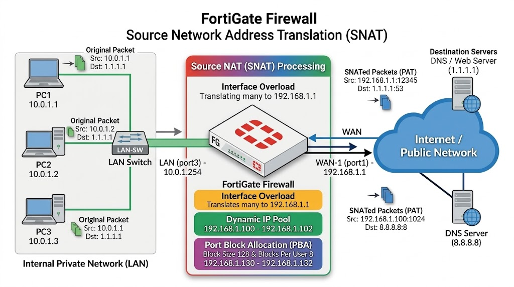
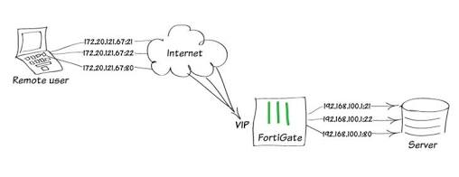

# Network Address Translation

## NAT

### 背景與核心目的（Background & Objective）

* **背景與動機**：IPv4 公有位址（Public IP）資源極度匱乏，且私有 IP 網段（RFC 1918，如 `10.0.0.0/8`、`192.168.0.0/16`）依標準無法在公共網際網路上直接路由。此外，企業與家庭內網各終端若直接暴露於外部網路，將面臨嚴重的資安威脅。

* **欲填補之研究缺口**：如何在單一或有限的公網 IP 環境下，使多個私有網段終端（如拓撲中的 PC1–PC3 等大量主機）順暢連通網際網路，同時隱匿內網真實拓撲結構以達成邊界安全防護。

### 架構設計與運作本質（Methodology / Architectural Design）

以 FortiGate 防火牆為核心邊界網關，串接內部區域網路（LAN/DMZ）與外部公網（WAN/Internet）。

* **工具與分析方式**：
    * **協議層級機制**：
        * **傳統 NAT**：運作於 OSI Layer 3（網路層），僅修改 IP 封包標頭（IP Header）中的來源或目的位址。
        * **PAT（Port Address Translation）/ NAPT**：跨越 OSI Layer 3 與 Layer 4（傳輸層），同時轉換 IP 位址與 TCP/UDP 埠號（Port Number），實現「多對一（Many-to-One / Overload）」共用單一公網 IP。

* **FortiOS 7.4.12 實現架構**：
    1. **Firewall Policy NAT（政策內嵌模式）**：FortiOS 預設行為，直接在個別安全策略（`config firewall policy`）中啟用 `set nat enable`，適合中小規模或直覺式部署。
    2. **Central NAT（集中管理模式）**：將位址轉換邏輯（`config firewall central-snat-map`）與安全檢查策略解耦分開，提供大規模複雜網路更精細的控制度與靈活性。


### 關鍵機制與驗證流程（Key Findings & Verification Workflow）

* **位址轉換分類與方向性**：
    * **Source NAT (SNAT)**：轉換出站流量（Egress）的來源 IP/Port，供內網主機主動出網使用，達成 IP 隱匿。
    * **Destination NAT (DNAT / VIP)**：轉換入站流量（Ingress）的目的 IP/Port，將外部公網請求映射至內部私有伺服器（Virtual IP）。

* **資源節約與安全效益**：
    * 透過 PAT Overload 機制，可讓數百台私有主機共享單一出口 IP。
    * 外部網路僅能看見防火牆外部介面的公網 IP，無法得知或直接路由至內部真實 IP，實質提升內部網路防護等級。


### 實務意涵與設計建議（Implications）

* **實務與學術貢獻**：NAT/PAT 是延緩 IPv4 耗盡危機的最關鍵技術，並奠定了現代狀態防火牆（Stateful Firewall）的基礎會話追蹤（Session Tracking）與存取控制架構。

* **研究限制與未來方向**：
    * **端到端完整性破壞**：NAT 破壞了 IP 層端到端連通性（End-to-End Principle），若應用層協議在 Payload 中封裝 IP（如 SIP、FTP），需額外倚賴 FortiOS 的 ALG（應用層網關）機制處理。
    * **長遠演進**：NAT 僅為過渡期解法，終極目標仍需逐步往 IPv6 原生環境遷移，或採用 FortiOS 所支援的 NAT64 等過渡技術進行雙棧互通。

## NAT Type

### 背景與核心目的（Background & Objective）

* **背景與動機**：在企業邊界安全與網路互聯中，位址轉換需求日益複雜多樣，涵蓋內網終端主動連網、公網用戶存取內部應用伺服器，以及不同規模下的流量分配與埠號管理需求。

* **欲填補之研究缺口**：單一的 NAT 機制無法同時滿足雙向通訊、多租戶環境以及精細化埠號控制；因此需在 FortiOS 架構下，系統性歸納與劃分 Source NAT（SNAT）與 Destination NAT（DNAT）之實作分支與配置模式。

### 架構設計與本質對比（Methodology / Conceptual Comparison）

* **以 FortiGate 防火牆之 FortiOS 7.4.x / 7.6.x 核心為基準，將網路位址轉換（NAT）依據**流量方向**與**控制模式**進行分類剖析。

* **管理維度劃分（Management Mode）**：
    * **Firewall Policy NAT**：將位址轉換設定直接內嵌於安全性規則中。
    * **Central NAT**：將位址映射與策略解耦，透過獨立的 Central SNAT / DNAT 映射表進行集中控制。


* **轉換機制分類（Translation Mechanics）**：
    * **Source NAT（出站轉換）**：
        * *Static NAT*：一對一固定映射。
        * *Dynamic NAT（IP Pool 演算法）*：細分為 **Overload**（PAT，多對一/多對少共用埠號）、**One-to-One**（無 PAT 的動態單一 IP 映射）、**Fixed Port Range**（依演算法固定分配客戶端埠號範圍）與 **Port Block Allocation (PBA)**（預先切塊分配端口區塊，降低 Log 記錄負載）。
        * *Central SNAT*：獨立配置之集中式來源位址轉換表。

    * **Destination NAT（入站轉換 / VIP 機制）**：
        * *Virtual IP Static*：靜態一對一外部 IP 映射至內部私有 IP。
        * *Virtual IP with Services*：限定特定協議服務的虛擬 IP 映射。
        * *Virtual IP with Port Forwarding*：指定外部連接埠轉發至內部主機特定連接埠（Port Forwarding）。

### 關鍵機制（Key Findings）

* **雙向流量之分流架構**：
    * **SNAT** 嚴格專注於出站流量（Outbound），實現內部私有 IP 的隱匿與公網 IP 的多工共用。
    * **DNAT** 核心依賴 Virtual IP（VIP）物件處理入站流量（Inbound），向公網發布內部服務。

* **靈活性與性能取捨**：
    * 在大型 ISP 或高併發企業網路中，Dynamic NAT 的 **Port Block Allocation (PBA)** 能有效緩解傳統 Overload 產生巨量會話日誌（Session Logging）的負擔。
    * **Central NAT** 提供了超越傳統 Policy-based NAT 的獨立策略維護能力，在多 WAN 或複雜多路由拓撲下維護成本更低。


### 結論與價值（Implications）

* **限制與未來方向**：此分類主要聚焦於 IPv4-to-IPv4（NAT44）架構；隨 IPv6 推進，後續應進一步納入 NAT64、DNS64 及 Carrier-Grade NAT (CGNAT) 於大型數據中心與電信網路之整合機制。

## Source Network Address Translation

### Background / Objective（背景與核心目的）

* **核心情境與動機**：在企業與資料中心網路中，內部私有主機（RFC 1918 私有 IP）需主動發起對外網或 Internet（如 Public IP `8.8.8.8`）的連線存取。為了突破私有位址無法直接於網際網路路由之限制，並保護內部網路拓撲不被外部窺視，必須在邊界安全閘道器（如 FortiGate）實施位址轉換。

* **欲解決之核心問題**：透過 SNAT（Source Network Address Translation）在封包送出（Outbound）時改寫 IP Header 內部的來源 IP 與 L4 Header（TCP/UDP）的來源埠號，達成「隱蔽內部真實 IP 拓撲」、「阻絕外網未授權直接連線」以及「多設備共享有限公網 IP（Port Multiplexing / PAT）」之核心目的。


### Methodology & Architecture（架構分類與實作模式）

在 FortiOS 7.4 架構下，SNAT 主要分為兩大架構分支：**Policy-based SNAT（內嵌於防火牆策略）** 與 **Central SNAT（集中化獨立策略表）**。其中底層位址轉換模式可拆解為三大類型：

```
Source Network Address Translation (SNAT)
├── 1. Overload SNAT (Static NAT / Interface PAT)
├── 2. Dynamic SNAT (IP Pool 機制)
│    ├── Overload (多對多動態 PAT)
│    ├── One-to-One (純動態 1:1 NAT，禁用 PAT)
│    ├── Fixed Port Range (內部範圍與外部範圍固定映射)
│    └── Port Block Allocation (PBA，按使用者區塊配額)
└── 3. Central SNAT (策略解耦，集中化映射表)
```

從架構圖如下

```text
                  +-----------------------------------+
                  | Network Address Translation (NAT) |
                  +-----------------+-----------------+
                                    |
                                    v
                          +-------------------+
                          | Source NAT (SNAT) |
                          +---------+---------+
                                    |
        +---------------------------+---------------------------+
        |                           |                           |
        v                           v                           v
+---------------+           +---------------+           +---------------+
|  Static NAT   |           |  Dynamic NAT  |           | Central SNAT  |
|  (出網介面 IP) |           |   (IP Pool)   |           | (獨立集中映射表)|
+---------------+           +-------+-------+           +---------------+
                                    |
         +-----------------+--------+--------+-----------------+
         |                 |                 |                 |
         v                 v                 v                 v
   +------------+    +------------+    +------------+    +------------+
   |  Overload  |    | One-to-One |    | Fixed Port |    | Port Block |
   | (PAT 多對多)|    | (關閉 PAT) |    |   Range    |    | Allocation |
   +------------+    +------------+    +------------+    +------------+

```


1. **Overload SNAT（Interface NAT / PAT）**：
    * 直接借用 FortiGate 出口介面（Outgoing Interface）的 IP 位址作為轉換後的公網 IP。
    * 仰賴單一 IP 的 TCP/UDP Source Port 進行多工分流（單一 IP 理論可用埠約 60,416 個，即扣除保留埠後的可用範圍）。


2. **Dynamic SNAT（IP Pool 機制）**：
    * 獨立於出向介面 IP 之外，在 `Policy & Objects > IP Pools` 定義專屬的外部 IP 範圍（單一或連續網段），並綁定至防火牆政策中。


3. **Central SNAT（架構解耦模式）**：
    * 於 `System > Settings` 開啟 `Central SNAT`（或在 Policy-based NGFW 模式下自動啟用）。
    * 將「安全訪問控制（Security Policy）」與「位址轉換（NAT Table）」完全解耦；防火牆策略內不再設定 NAT，改由獨立的 Central SNAT 規則表依據 Top-down 順序由上而下進行匹配。

### 3. Key Findings & IP Pool 體系剖析（核心發現與機制對比）

根據 FortiOS 7.4 的連線追蹤（`get system session list`）與核心排隊機制，Dynamic IP Pool 的四種模式展現出本質性的行為差異：

| 模式名稱 | PAT 啟用狀態 | 內部 IP 限制與對應邏輯 | 核心運作行為與瓶頸考量 |
| --- | --- | --- | --- |
| **Overload** | **啟用** | 不限制內部 IP 範圍；多對一或多對多 | 採用循環復用模式；可用 Session 數為 $60,416 \times N$（$N$ 為 Pool 內公網 IP 數量），支援極大規模連線併發。 |
| **One-to-One** | **停用 (No PAT)** | 內部與外部主機為純 1:1 暫態綁定 | **先進先出（FIFO / First-come, First-served）**；當 Pool 內 IP 耗盡時（如 2 個 IP 被 2 台 PC 佔用），後續第 3 台連線將被直接 Drop，直到既有 Session 過期或手動清除。 |
| **Fixed Port Range** | **啟用** | **必須嚴格綁定**內部起始/結束 IP 範圍 | 將特定內部 IP 網段與外部 IP/Port 區間進行可預期且確定的數學映射，便於審計追蹤來源。 |
| **Port Block Allocation (PBA)** | **啟用** | 不限制內部 IP，但限制每位使用者的 Port 區塊 | 定義 `Block Size`（每區塊 Port 數）與 `Block Per User`（每人配額），防止單一惡意或高併發主機（如 P2P、爬蟲）耗盡全域 NAT 埠位資源。 |

#### 關鍵排錯與狀態觀察

* **Session 鎖定現象**：在 `One-to-One` 模式下，即便連線暫停，只要 FortiOS Session Table（`diagnose sys session list` / `40-View Session`）未達逾時期限（Aging Timeout），該公網 IP 依然處於保留狀態，導致後續連線無法搶佔。

* **Central SNAT 啟用約束**：若現有 IPv4 Firewall Policy 內已有參照 Dynamic IP Pool 或勾選 NAT，系統將拒絕直接於 Settings 中啟用 Central SNAT，必須先將現有政策中的 NAT 參照移除才能順利移轉。


### Implications & Practical Engineering Insights（實務意涵與工程建議）

1. **架構選型考量（Interface SNAT vs. Central SNAT）**：
    * 一般企業分支出口可直接採用 **Interface Overload** 或簡單的 **Policy-based IP Pool**，佈署快觀速且直。

    * 中大型資料中心、電信級架構或具備多出口/多租戶環境，強烈建議導入 **Central SNAT**。解耦後能大幅收斂安全政策條目，並可基於 Source IP、Destination IP 或特定 Port 精準導引至不同的公網 IP Pool，降低維運管理複度。


2. **防範資源耗盡（Noisy Neighbor Problem）**：
    * 面對內部大量終端連線時，純 `Overload` 可能面臨單一使用者發起數萬個 TCP 連線而擠壓正常業務的風險。
    * 於大規模公眾 Wi-Fi、校園網或多租戶容器環境中，建議優先採用 **Port Block Allocation (PBA)** 搭配 Session Limit，確保每位內部使用者享有對等的出口埠位配額，提升整體 NAT 資源的隔離度與韌性。


3. **日誌稽核與法令遵從（CGNAT 審計場景）**：
    * 若法規要求精確回溯特定公網連線對應之內部私有主機，傳統動態 Overload 需紀錄大量 NAT Translation Log（日誌量巨大）；此時導入 **Fixed Port Range** 能以靜態演算法精準推算來源映射，大幅降低 Syslog 儲存負擔。

## Source Interface Overload NAT 

在 FortiOS 7.4 架構中，**Policy Source Interface Overload NAT**（通常亦稱為 Interface NAT、Interface PAT 或出向介面超載靜態 NAT）是內部私有網路存取網際網路最常見的配置。其運作核心是將所有匹配安全策略的內部私有 IP（例如 `10.0.1.0/24`）改寫為 FortiGate 出口介面的 IP 位址（例如 `192.168.1.1`），並透過 L4 連接埠多工（Port Address Translation, PAT）區分不同連線（單一 IP 理論約有 60,416 個可用連接埠）。

### GUI 圖形介面設定路徑

#### 前置確認（路由確認）

為確保測試流量精準走指定的 WAN 介面，請確認預設路由（Static Route）與策略路由（Policy Route）：

* **停用干擾的策略路由**：至 **Network > Policy Routes**，若有特定策略路由導向其他介面，先將其 **Disable**。
* **確認預設路由**：至 **Network > Static Routes**，確認往外網的預設路由（`0.0.0.0/0`）指向正確的出口介面（例如 `WAN-1 (port1)`，Gateway `192.168.1.254`）。

#### 防火牆策略配置（啟用 Interface NAT）

1. 進入導覽列：**Policy & Objects > Firewall Policy**。
2. 點選 **Create New** 或雙擊既有的出向策略進行編輯（例如內網通往外網的政策）：

    * **Incoming Interface**：選擇內部網段介面（例如 `LAN (port3)`）。
    * **Outgoing Interface**：選擇外部出口介面（例如 `WAN-1 (port1)`）。
    * **Source**：選擇內部來源位址物件（例如 `all` 或 `10.0.1.0/24`）。
    * **Destination**：選擇目的地（通常為 `all` 或特定網段）。
    * **Service**：選擇服務類型（例如 `ALL`）。
    * **Action**：設定為 `ACCEPT`。

3. 滾動至 **Firewall / Network Options** 區塊：

    * **NAT**：將開關切換為 **Enable**（開啟）。
    * **IP pool configuration**：選擇 **Use Outgoing Interface Address**（此即 Interface Overload 模式，不需勾選 Use Dynamic IP Pool）。

4. 點選 **OK** 儲存套用。

### CLI 命令列設定方式

在 FortiOS 7.4 中，防火牆安全政策設定位於 `firewall policy` 樹狀層級下：

```fortios
config firewall policy
    edit 1
        set name "LAN_to_WAN_Overload"
        set srcintf "port3"               # 內部介面 (LAN)
        set dstintf "port1"               # 外部介面 (WAN-1)
        set action accept
        set srcaddr "all"
        set dstaddr "all"
        set schedule "always"
        set service "ALL"
        
        # --- 核心 Overload NAT 設定 ---
        set nat enable                    # 啟用 SNAT 功能
        # 注意：當 nat enable 且未指定 ippool enable 時，
        # FortiOS 預設行為即為使用 Outgoing Interface Address
    next
end

```

> **CLI 語法補充說明**：
> 若先前曾手動綁定過 IP Pool，欲還原為 Interface Overload，可使用以下指令關閉 IP Pool，自動退回介面位址轉換模式：
> ```fortios
> config firewall policy
>     edit 1
>         set nat enable
>         unset ippool                      # 或 set ippool disable
>         unset poolname
>     next
> end
> 
> ```
> 
> 


### 驗證與連線追蹤（Verification）

當內部客戶端（例如 `10.0.1.1`）向外網（如 `1.1.1.1` 或 `8.8.8.8`）發起連線時，可透過以下三種方式驗證 SNAT 改寫狀態：

#### 1. CLI 連線工作階段清單（Session Table）

執行檢視指令，確認內部來源已被改寫為外部介面 IP（`192.168.1.1`）：

```fortios
# 檢視目前所有作用中的 Session
get system session list

# 篩選特定 ICMP 封包檢視 SNAT 狀態
get system session list | grep icmp

# 篩選特定外部目的 IP
get system session list | grep 1.1.1.1

```

*預期輸出特徵*：

在輸出欄位中，會看到 `SOURCE` 為內部 IP（`10.0.1.1:port`），而對應的 `SOURCE-NAT` 欄位已被替換為出向介面 IP（`192.168.1.1:port`）。

若需清除所有既有連線以利即時測試：

```fortios
diagnose sys session clear

```

#### 2. GUI FortiView 追蹤

* 前往 **Dashboard > FortiView Sessions**。
* 在篩選器輸入內部來源 I[IP_ADDRESS]0.1.1`）。
* 檢查 **Destination Interface** 為 `WAN-1 (port1)`，且 **Source NAT Address** 欄位明確顯示為出口介面 IP `192.168.1.1`。


#### 3. GUI 轉發流量日誌（Forward Traffic Logs）

* 前往 **Log & Report > Forward Traffic**。
* 篩選 `Source: 10.0.1.1`，檢查日誌詳細資訊中的 **Source NAT IP** 欄位是否為 `192.168.1.1`。

---

### 常見注意事項與架構限制

1. **Central SNAT 衝突**：若系統目前啟用了 Central SNAT（或 NGFW 處於 Policy-based 模式），防火牆策略內的 NAT 設定區塊會被隱藏，所有的 SNAT 必須移至 **Policy & Objects > Central SNAT** 進行獨立管理。


2. **連接埠耗盡（Port Exhaustion）**：單一介面 IP 具備約 60,416 個動態來源連接埠可供 PAT 復用。若內部主機規模龐大或有大量 P2P、爬蟲等極端併發情境，建議改用 **Dynamic IP Pool（Overload 或 PBA 模式）** 擴充出口公網 IP 數量。

## Policy Source Overload LAB

### Background / Objective（背景與核心目的）

* **核心情境與動機**：在先前配置中，出向流量使用的是單一外部介面 IP（Interface Overload）。當內部主機數量擴大、連線併發量激增，單一公網 IP 所具備的 60,416 個可用連接埠（Port）可能面臨耗盡風險。

* **欲解決之核心問題**：透過設定 **Dynamic SNAT - Overload IP Pool**，提供一個獨立的外部 IP 範圍（例如 `192.168.1.100 - 192.168.1.102`，共 3 個公網 IP），使內部多個主機（`10.0.1.0/24`）在出向時能動態分配並重複利用這些 IP 的連接埠（多對多 PAT），將連線容量大幅倍增至 $60,416 \times 3 \approx 181,248$ 個工作階段。

### 2. Methodology & Architecture（設定流程與實作方式）

此架構包含兩大配置階段：**建立動態 IP Pool 物件** 與 **在防火牆安全政策中呼叫綁定**。

#### GUI 圖形介面操作路徑

1. **建立 Dynamic IP Pool**：
    * 前往 **Policy & Objects > IP Pools**，點選 **Create New**。
    * **Name**：輸入識別名稱（例如 `SNAT-Overload`）。
    * **Type**：選擇 **Overload**（多對一/多對多動態 PAT）。
    * **External IP Range**：填入外部 IP 範圍（例如 `192.168.1.100-192.168.1.102`）。
    * 點選 **OK** 儲存。

2. **於防火牆策略中啟用並綁定 IP Pool**：
    * 前往 **Policy & Objects > Firewall Policy**，雙擊編輯出向策略（例如 LAN 到 WAN-1）。
    * 滾動至 **Firewall/Network Options**：
        * **NAT**：切換為 **Enable**。
        * **IP pool configuration**：由預設的 *Use Outgoing Interface Address* 改選為 **Use Dynamic IP Pool**。
        * 點選 **+** 號，選取剛建立的 IP Pool 物件（`SNAT-Overload`）。
    * 點選 **OK** 套用。

#### CLI 命令列設定方式

```fortios
# 步驟 1：建立 Dynamic Overload IP Pool 物件
config firewall ippool
    edit "SNAT-Overload"
        set type overload
        set startip 192.168.1.100
        set endip 192.168.1.102
        set comments "SNAT-Overload Pool"
        set arp-reply enable       # 預設啟用，FortiGate 會代為回應此範圍的 ARP 請求
    next
end

# 步驟 2：於防火牆安全策略中呼叫該 IP Pool
config firewall policy
    edit 1
        set name "LAN_to_WAN_Dynamic_NAT"
        set srcintf "port3"        # 內部介面 (LAN)
        set dstintf "port1"        # 外部介面 (WAN-1)
        set action accept
        set srcaddr "all"
        set dstaddr "all"
        set schedule "always"
        set service "ALL"
        
        # --- 啟用動態 IP Pool 轉換 ---
        set nat enable
        set ippool enable
        set poolname "SNAT-Overload"
    next
end

```

### Key Findings & Verification（核心驗證與行為分析）

當內部客戶端（`10.0.1.1`、`10.0.1.3`、`10.0.1.4` 等）發起對外流量（如 `1.1.1.1` 或 `8.8.8.8`）時，透過以下方式驗證 IP Pool 運作狀態：

#### CLI 連線工作階段清單（Session List）

在測試前建議清除既有快取工作階段：

    ```fortios
    FW1 # diagnose sys session clear

    ```

發起流量後檢視 Session 改寫狀態：

    ```fortios
    FW1 # get system session list
    # 或精準篩選
    FW1 # get system session list | grep icmp
    FW1 # get system session list | grep 1.1.1.1

    ```

* **觀察成果**：
    在 `SOURCE-NAT` 欄位中，可觀察到來源 IP 已不再固定為介面 IP（`192.168.1.1`），而是動態分派至 Pool 範圍內：
        * `10.0.1.1` 被轉換為 `192.168.1.100:port`
        * `10.0.1.3` 被轉換為 `192.168.1.102:port`

#### GUI FortiView 與轉發日誌

* **Dashboard > FortiView Sessions**：在篩選器輸入來源網段（`10.0.1.0/24`），可見連線的 **Source NAT Address** 分別落在 `192.168.1.100` 或 `192.168.1.102`。

* **Log & Report > Forward Traffic**：篩選 `Source: 10.0.1.1, 10.0.1.4`，檢視 **Source NAT IP** 欄位已由單一介面 IP 改為 IP Pool 範圍位址。

### Implications & Engineering Insights（實務意涵與關鍵細節）

1. **Proxy ARP 機制（`arp-reply enable`）**：
    * 當 IP Pool 設定的公網 IP 網段與出口介面屬於同一個 Layer 2 Broadcast Domain，但又不是直接綁定在實體介面上的 IP 時，FortiOS 預設會啟用 `set arp-reply enable`。

    * 這意味著 FortiGate 會自動針對上游閘道器對這些 Pool IP 的 ARP 請求進行代理回應（Proxy ARP），無需在介面上設定 Secondary IP 即可正常收發回程流量。


2. **PAT 雜湊與負載均衡行為**：
    * 在 `Overload` 模式下，FortiOS 會依據內部來源 IP、目的 IP 與 Port 進行演算法雜湊運算，將工作階段分散到 Pool 內的各個外部 IP 上。
    * 多台內部主機可能共用同一個 Pool IP（藉由不同的外部 Port 區隔），一旦該 IP 連接埠使用率過高或依輪詢機制，後續流量會自動使用下一個 Pool IP。

3. **與 Central SNAT 之相容性**：
    * 在此模式下建立的 IP Pool 物件（`SNAT-Overload`），未來若全域架構升級並啟用 **Central SNAT**，該 IP Pool 物件可直接被 Central SNAT 規則無縫重複引用，無須重新定義。

## Source One-To-One NAT Lab

### Background / Objective（背景與核心目的）

* **核心情境與動機**：在特定網路安全架構或專用協定交互中，應用程式可能無法相容連接埠多工（Port Address Translation, PAT），或是業務情境要求內部主機連線至外網時必須具備專屬的公網 IP 映射，而不得與其他主機共用 IP。

* **欲解決之核心問題**：透過設定 **Dynamic SNAT - One-to-One IP Pool**，提供一組連續的公網 IP 範圍（例如 `192.168.1.110 - 192.168.1.111`，共 2 個 IP）。在此模式下 **PAT 被完全停用**，內部主機（`10.0.1.0/24`）採「先到先得（First-come, First-served / FIFO）」原則獨佔轉換 IP，驗證當 Pool 內 IP 耗盡時後續連線被阻斷的邊行為。


### Methodology & Architecture（設定流程與實作方式）

**建立 One-to-One IP Pool 物件** 與 **在防火牆安全政策中抽換綁定**：

```
Dynamic SNAT (One-to-One Pool: 192.168.1.110-192.168.1.111)
├── 內部主機 PC1 (10.0.1.1) ──(搶佔)──> 外部 IP: 192.168.1.110 (PAT 停用)
├── 內部主機 PC2 (10.0.1.4) ──(搶佔)──> 外部 IP: 192.168.1.111 (PAT 停用)
└── 內部主機 PC3 (10.0.1.2) ──(無可用 IP)──> 封包被直接丟棄 (Drop / Rejected)

```

#### GUI 圖形介面操作路徑

1. **建立 One-to-One Dynamic IP Pool**：
    * 前往 **Policy & Objects > IP Pools**，點選 **Create New**。
    * **Name**：輸入識別名稱（例如 `SNAT-One-to-One`）。
    * **Type**：選擇 **One-to-One**（純動態 1:1 NAT，不實施 Port 轉換）。
    * **External IP Range**：填入外部 IP 範圍（例如 `192.168.1.110-192.168.1.111`）。
    * 確認 **ARP Reply** 為開啟狀態（系統預設）。
    * 點選 **OK** 儲存。

2. **防火牆安全政策綁定**：
    * 前往 **Policy & Objects > Firewall Policy**，編輯既有的出向策略（LAN 到 WAN-1）。
    * 於 **Firewall/Network Options** 區塊：
        * 確認 **NAT** 為 **Enable**。
        * **IP pool configuration** 保持為 **Use Dynamic IP Pool**。
        * 選 `SNAT-One-to-One`。
        * 點選 **OK** 儲存套用。

#### CLI 命令列設定方式

```fortios
# 步驟 1：建立 One-to-One 類型的 IP Pool
config firewall ippool
    edit "SNAT-One-to-One"
        set type one-to-one
        set startip 192.168.1.110
        set endip 192.168.1.111
        set comments "SNAT-One-to-One Pool"
        set arp-reply enable
    next
end

# 步驟 2：於防火牆安全策略中呼叫綁定
config firewall policy
    edit 1
        set name "LAN_to_WAN_OneToOne"
        set srcintf "port3"
        set dstintf "port1"
        set action accept
        set srcaddr "all"
        set dstaddr "all"
        set schedule "always"
        set service "ALL"
        
        # --- 綁定 One-to-One IP Pool ---
        set nat enable
        set ippool enable
        set poolname "SNAT-One-to-One"
    next
end

```


### Key Findings & Pool 耗盡實證（核心發現與排錯驗證）

#### 1. 先到先得與排隊耗盡現象（FIFO Mechanism）

* 當 PC1（`10.0.1.1`）與 PC2（`10.0.1.4`）發起連線時，分別成功取得 `192.168.1.110` 與 `192.168.1.111`。

* 此時 Pool 內 2 個 IP 已達 100% 滿載：
    * **第三台主機 PC3 發起連線時，封包將無法通過並直接被阻斷（Ping 失敗無回應）**。
    * 只有在 PC1 或 PC2 停止通訊，且 FortiOS 的工作階段過期（或網管手動清除 Session）釋放位址後，PC3 才能搶佔取得外部 IP。


#### 2. 底層狀態檢驗指令

* **檢查 IP Pool 實際佔用狀態與失敗計數**：
```fortios
FW1 # diagnose firewall ippool list

```


*輸出關鍵觀察點*：
    * `inuse-NAT-IPs=2`：代表外部 2 個 IP 全數處於被佔用狀態。
    * `free-PBAs=0.00%`：代表已無剩餘可用配額。
    * `failed-clients=17`：明確記錄因 Pool 耗盡而連線失敗的客戶端次數。
    * `fixed-port=yes`：底層 Port 轉換處於非多工固定狀態。


* **檢視連線工作階段**：
```fortios
FW1 # get system session list | grep icmp

```

可看見 `10.0.1.1` 轉換為 `192.168.1.110`，`10.0.1.4` 轉換為 `192.168.1.111`，呈現嚴格的 1 對 1 映射。

* **手動清除工作階段以恢復連線**：
```fortios
FW1 # diagnose sys session clear

```

清除後原本卡住的 PC3 即可成功發起連線並搶佔 IP。

### Implications & Practical Engineering Insights（實務意涵與設計限制）

1. **容量規劃與連線併發限制**：
    * `One-to-One` 模式的出口容量完全取決於 **Pool 內公網 IP 的數量**，完全喪失了 PAT 連接埠多工的節省優勢。
    * 不適用於大量終端存取網際網路的日常場景；僅建議用於：特定金融 API/專用協定通訊（限制單一來源不得隨機改寫 Port）、舊式語音協定、或需要依 IP 精準對帳審計的特定邊界系統。


2. **Session Aging（工作階段老化）與阻斷風險**：
    * 即使終端已結束資料傳送，FortiOS 的 TCP/UDP/ICMP Session Timer 仍可能維持數十秒至數千秒（例如 TCP 預設閒置逾時）。在這段時間內，該公網 IP 仍被判定為 `inuse`，其他主機將持續遭遇阻斷。
    * 若必須使用動態 Pool 且內部主機多於外部 IP，應優先採用 **Overload** 或 **Port Block Allocation (PBA)**。

## Source Fixed Port Range NAT Lab

### Background / Objective（背景與核心目的）

* **核心情境與動機**：在電信服務供應商（ISP）、校園網或嚴格合規（Compliance）的企業環境中，傳統動態 Overload NAT 產生的「不確定來源埠映射」會導致大量 NAT 轉發日誌（Syslog），在追查資安犯罪或版權問題時面臨龐大的審計負擔。

* **欲解決之核心問題**：透過設定 **Dynamic SNAT - Fixed Port Range IP Pool**，建立內部私有 IP 與外部公網 IP/Port 區間的可預測、固定數學映射關係。同時，此模式具備內部 IP 網段過濾（Internal IP Range）能力，僅允許在名單內的內部 IP 借用該 Pool 連外，不在範圍內的主機連線將被直接阻斷。


### Methodology & Architecture（設定流程與實作方式）

此架構包含 **建立 Fixed Port Range IP Pool 物件（需同時指定內外網段）** 與 **在防火牆安全政策中呼叫綁定**：

```
Fixed Port Range IP Pool
├── 外部公網 IP 範圍 (External IP Range): 192.168.1.120 - 192.168.1.121 (預設 Port 5117-65533)
└── 內部私有 IP 範圍 (Internal IP Range): 10.0.1.1 - 10.0.1.10
      ├── 10.0.1.1 ~ 10.0.1.10 (在範圍內) ──> 依固定演算法分派外部 IP 與特定 Port 區塊連外
      └── 10.0.1.1 (若調整為 10.0.1.2 起始) ──> 不在範圍內，連線直接丟棄 (Request timed out)

```

#### GUI 圖形介面操作路徑

1. **建立 Fixed Port Range IP Pool**：
    * 前往 **Policy & Objects > IP Pools**，點選 **Create New**。
    * **Name**：輸入識別名稱（例如 `SNAT-Fixed-Port-Range`）。
    * **Type**：下拉選取 **Fixed Port Range**。
    * **External IP Range**：填入外部 IP 範圍（例如 `192.168.1.120-192.168.1.121`）。
    * **Internal IP Range**：填入允許轉換的內部 IP 範圍（例如 `10.0.1.1-10.0.1.10`）。
    * **Start port / End port**：系統預設帶入 `5117` 與 `65533`（可依需求微調 Ports Per User 或配額）。
    * 確認 **ARP Reply** 為開啟（預設啟用）。
    * 點選 **OK** 儲存。


2. **防火牆安全政策綁定**：
    * 前往 **Policy & Objects > Firewall Policy**，雙擊編輯出向策略（LAN 到 WAN-1）。
    * 於 **Firewall/Network Options**：
        * 確認 **NAT** 為 **Enable**。
        * **IP pool configuration** 選擇 **Use Dynamic IP Pool**。
        * 點選 **+** 號，選取剛建立的 `SNAT-Fixed-Port-Range`。
        * 儲存套用。


#### CLI 命令列設定方式

```fortios
# 步驟 1：建立 Fixed Port Range 類型的 IP Pool
config firewall ippool
    edit "SNAT-Fixed-Port-Range"
        set type fixedport-range
        set startip 192.168.1.120
        set endip 192.168.1.121
        set source-startip 10.0.1.1
        set source-endip 10.0.1.10
        set portperuser 0            # 設為 0 時由系統依內外部 IP 數量自動平均切分 Port
        set comments "SNAT-Fixed-Port-Range Pool"
        set arp-reply enable
    next
end

# 步驟 2：於防火牆安全策略中呼叫綁定
config firewall policy
    edit 1
        set name "LAN_to_WAN_FixedPort"
        set srcintf "port3"
        set dstintf "port1"
        set action accept
        set srcaddr "all"
        set dstaddr "all"
        set schedule "always"
        set service "ALL"
        
        # --- 綁定 Fixed Port Range IP Pool ---
        set nat enable
        set ippool enable
        set poolname "SNAT-Fixed-Port-Range"
    next
end

```

### Key Findings & Verification（核心驗證與行為分析）

#### 1. 固定埠分配與連線驗證

* 當 PC1（`10.0.1.1`）、PC2（`10.0.1.2`）、PC3（`10.0.1.3`）發起連線時，皆能透過 `192.168.1.120` 正常轉發。

* 透過連線清單指令檢視 Session：

    ```fortios
    FW1 # get system session list

    ```
    在 `SOURCE-NAT` 欄位中，可觀察到特定內部主機的轉換 Port 均落在其預先分配好的專屬 Port 區塊內（如 `10.0.1.1` 的 TCP 埠集中在 `10280~10282` 區間）。

* 於 **Dashboard > FortiView Sessions** 或 **Log & Report > Forward Traffic** 檢視，來源均正常改寫為 `192.168.1.120`。


#### 2. 內部 IP 邊界排除實證（Internal IP Filtering）

* 若至 **Policy & Objects > IP Pools** 編輯 `SNAT-Fixed-Port-Range`，將 **Internal IP Range** 修改為 `10.0.1.2-10.0.1.10`（將 `10.0.1.1` 排除）：

* PC1（`10.0.1.1`）的連續 Ping（`ping 1.1.1.1 -t`）將**瞬間中斷並顯示 `Request timed out.**`。
    * 原因：Fixed Port Range 具備嚴格的雙向區間對齊機制；不在 `Internal IP Range` 清單內的主機即使通過了 Firewall Policy 的 `srcaddr`，也無法取得 NAT 資源而遭底層丟棄。
    * 將起始 IP 改回 `10.0.1.1` 後，PC1 立即恢復通訊。

### Implications & Practical Engineering Insights（實務意涵與工程建議）

1. **確定性 NAT（Deterministic NAT）與免日誌審計（CGNAT）**：
    * 傳統動態 PAT 每次連線皆隨機取埠，一旦司法或主管機關要求回溯「某年某月某分某秒該公網 IP:Port 屬於哪位內部用戶」，必須仰賴數百 GB 的 NAT Translation Log。
    * `Fixed Port Range` 透過演算法計算公式：

        $$\text{Port Per User} = \frac{(\text{End Port} - \text{Start Port} + 1) \times \text{外部 IP 數}}{\text{內部主機總數}}$$

    由於每個內部私有 IP 被分配的外部 IP 與 Port 區間是**固定且靜態已知的**，資安與網管人員直接依公式即可反查出特定用戶，可大幅減少甚至關閉龐大的動態 NAT 審計日誌。

2. **容量與擴充性限制（Trade-offs）**：
    * 若內部 IP 規模很大（例如 `/24` 達 250 台主機），而外部 IP 僅有 1 個時，每台主機分配到的可用 Port 會被壓縮至 $60,416 / 250 \approx 241$ 個埠，使用者開啟大量分頁或高連線應用時容易遭遇 Port 耗盡。
    * 因此規劃 Fixed Port Range 時，必須嚴格計算「內部主機總數」與「外部 IP 數量」，避免因每人分配埠數過低造成網頁載入不完全等問題。

## Source Port Block Allocation NAT

### Background / Objective（背景與核心目的）

* **核心情境與動機**：在大型企業、校園或服務供應商（ISP/Carrier）情境中，若直接使用傳統動態 Overload（PAT），所有內部主機將共用同一個連接埠池。這容易引發「吵鬧鄰居（Noisy Neighbor）」問題——當少數單一內部主機發起極端連線（如 P2P 下載、密集連線爬蟲、或被植入惡意程式向外泛洪）時，會瞬間耗盡公網 IP 的可用連接埠（約 60,416 個），導致其他正常使用者的連線無法建立。

* **欲解決之核心問題**：透過設定 **Dynamic SNAT - Port Block Allocation (PBA)**，將外部公網 IP 的連接埠切割為固定大小的區塊（Block），並限制每位內部使用者（以 Source IP 為單位）可獲得的區塊上限。藉此實現「**連接埠資源硬性配額隔離**」與「**大規模用戶動態共享**」，兼顧安全性、防止連線泛洪，並優化 NAT 審計日誌的產出量。

### Methodology & Architecture（設定流程與實作方式）

此架構包含 **建立 Port Block Allocation IP Pool 物件** 與 **在防火牆安全政策中呼叫綁定**：

```
Dynamic SNAT (Port Block Allocation: 192.168.1.130 - 192.168.1.132)
├── 可用外部連接埠區間: 5117 - 65533 (總計 60,417 個 Ports / 每 IP)
├── Block Size = 128 (每個區塊包含 128 個 Ports)
├── Blocks Per User = 8 (每台內部主機上限可取得 8 個區塊 = 1,024 個 Ports)
└── 分配機制:
      ├── 內部主機 PC1 (10.0.1.1) ──(發起首個連線)──> 借用 192.168.1.130 的 Block 1 (Port 5117~5244)
      ├── 內部主機 PC2 (10.0.1.2) ──(發起首個連線)──> 借用 192.168.1.130 的 Block 2 (Port 5245~5372)
      └── 單一主機超過 1,024 個連線 ──(觸發配額上限)──> 阻止額外端口分配，保護全域 Pool 不被耗盡

```

#### GUI 圖形介面操作路徑

1. **建立 Port Block Allocation Dynamic IP Pool**：
    * 前往 **Policy & Objects > IP Pools**，點選 **Create New**。
    * **Name**：輸入識別名稱（例如 `SNAT-Port-Block-Allocation`）。
    * **Type**：下拉選取 **Port Block Allocation**。
    * **External IP Range**：填入外部 IP 範圍（例如 `192.168.1.130-192.168.1.132`）。
    * **Start port / End port**：系統預設帶入 `5117` 與 `65533`。
    * **Block Size**：設定為 `128`（單一區塊包含的 Port 數量）。
    * **Blocks Per User**：設定為 `8`（每台內部主機最多可租借的區塊數）。
    * 確認 **ARP Reply** 為開啟（預設啟用）。
    * 點選 **OK** 儲存。


2. **防火牆安全政策綁定**：
    * 前往 **Policy & Objects > Firewall Policy**，雙擊編輯出向策略（LAN 到 WAN-1）。
    * 於 **Firewall/Network Options**：
        * 確認 **NAT** 為 **Enable**。
        * **IP pool configuration** 選擇 **Use Dynamic IP Pool**。
        * 選取剛建立的 `SNAT-Port-Block-Allocation`。
        * 儲存套用。

#### CLI 命令列設定方式

```fortios
# 步驟 1：建立 Port Block Allocation 類型的 IP Pool
config firewall ippool
    edit "SNAT-Port-Block-Allocation"
        set type port-block-allocation
        set startip 192.168.1.130
        set endip 192.168.1.132
        set blocksize 128
        set num-blocks-per-user 8
        set startport 5117
        set endport 65533
        set comments "SNAT-Port-Block-Allocation Pool"
        set arp-reply enable
    next
end

# 步驟 2：於防火牆安全策略中呼叫綁定
config firewall policy
    edit 1
        set name "LAN_to_WAN_PBA"
        set srcintf "port3"
        set dstintf "port1"
        set action accept
        set srcaddr "all"
        set dstaddr "all"
        set schedule "always"
        set service "ALL"
        
        # --- 綁定 PBA IP Pool ---
        set nat enable
        set ippool enable
        set poolname "SNAT-Port-Block-Allocation"
    next
end

```

---

### Key Findings & CLI 核心參數詳細說明

在設定與維護 PBA 時，FortiOS 7.4.12 的底層參數及其運作邏輯如下：

#### CLI 核心設定參數解析（`config firewall ippool`）

* **`set type port-block-allocation`**：宣告此 IP Pool 採用區塊化動態連接埠分派演算法，取代傳統隨機 PAT 或靜態固定映射。
* **`set startip` / `set endip**`：定義可供轉換的外部公網 IP 起訖位址（本例為 `192.168.1.130` 至 `192.168.1.132`，共 3 個公網 IP）。
* **`set blocksize 128`**：
    * **參數意涵**：每個分配單位（Port Block）所包含的連續連接埠數量。
* **計算邏輯**：單一外部 IP 的可用埠範圍為 $65533 - 5117 + 1 = 60417$ 個埠。當 `blocksize` 設為 128 時，單一公網 IP 可切割出 $\lfloor 60417 / 128 \rfloor = 472$ 個獨立區塊（即 GUI 浮現的 `block per IP is 472`）。
* **`set num-blocks-per-user 8`**：
    * **參數意涵**：單一內部私有 IP（User）最多可同時租借的區塊數量（配額上限）。
* **容量控制**：單一用戶最多能同時發起的連線總數為 $128 \times 8 = 1024$ 個連線。當用戶連線數超出 128 時，FortiOS 會按需分配第 2 個區塊，直至達到 8 個區塊上限；一旦超過，超額連線會被丟棄，防止單一主機佔用過多公網資源。
* **`set startport 5117` / `set endport 65533**`：定義允許用於 PAT 轉換的連接埠區間，避開系統常用的 Well-known Ports（1~1023）與 Registered Ports（1024~5000），確保 NAT 與底層協定不衝突。
* **`set arp-reply enable`**：啟用 FortiGate 代理回應外部網路對此 IP 範圍發起的 ARP 請求（Proxy ARP），無需在實體介面新增 Secondary IP。


#### 狀態檢驗與連線追蹤指令

1. **檢視連線工作階段（Session List）**：
    ```fortios
    FW1 # get system session list
    ```


    *現象觀察*：當 PC1（`10.0.1.1`）、PC2（`10.0.1.2`）、PC3（`10.0.1.3`）發起連線時，其 `SOURCE-NAT` 欄位均轉換為 `192.168.1.130`，但其分配的 Port（如 `5118`、`5162`、`5233`、`5375`）皆嚴格落在分配給各主機的 128-port 區塊中。


2. **檢視 IP Pool 區塊使用率與租借狀態**：
    ```fortios
    FW1 # diagnose firewall ippool list

    ```

    *關鍵指標*：
        * `total-PBAs`：該 Pool 總共切割出的 Port Block 總數（3 個 IP $\times 472 = 1,416$ 個 PBAs）。
        * `inuse-PBAs`：目前被內部主機租借中的 Block 數量。
        * `clients`：目前正在使用此 Pool 的內部客戶端數量。
        * `allocate-PBA-times` / `reuse-PBA-times`：區塊被指派與釋放後重新復用的計數器。

### Implications & Practical Engineering Insights（實務意涵與架構選型）

1. **Carrier-Grade NAT (CGNAT) 與日誌最佳化**：
    * 傳統動態 PAT 模式下，每次 TCP/UDP 連線建立與關閉都需要寫入一筆 Syslog，連線數龐大時會嚴重衝擊日誌伺服器效能。
    * 採用 PBA 時，FortiOS 僅在「為某內部 IP 指派/釋放一個 Port Block（如區塊 Port 5117~5244 分配給 10.0.1.1）」時記錄一筆日誌（Block Allocation Log）。在此區塊內的 128 個連線均不再重複記錄，**日誌量可降低 90% 以上**，兼具精準審計與高效能。

2. **動態擴展性與保護機制的平衡**：
    * 相較於 `Fixed Port Range`（必須預先指定精確的內部 IP 網段且每人配額死板），PBA 不需限制內部 IP 範圍，任何通過策略的內部主機皆可動態取得區塊。
    * 藉由 `num-blocks-per-user` 設下天花板，既保有一般動態 Overload 的高彈性，又具備防止 DoS/連線耗盡的安全邊界。

## 總結 FortiGate 來源位址轉換（SNAT）網路架構與封包流向圖

 from gemini

### Background / Objective（背景與核心架構目的）

* 核心架構拓撲：內部私有網段由各終端主機（PC1: 10.0.1. 1、PC2: 10.0.1.2、PC3: 10.0.1.3 等）匯聚至 LAN 交換器，並連接至 FortiGate 邊界防火牆的連入介面（port3 / LAN: 10.0.1.254）。
* 出向轉換與邊界防護：當內部主機發起存取外部公網（如 1.1.1.1、8.8.8.8）時，流量經由 FortiGate 的出向介面（port1 / WAN-1: 192.168.1.1）轉發至上游網際網路閘道（192.168.1.254）。
* 轉換目的：隱蔽內部真實私有 IP 拓撲結構，並透過安全策略與位址轉換表維護連線狀態。   

### Methodology / Architecture（封包路徑與轉發處理流程）

當內部客戶端封包進入 FortiGate 至離開網卡，其底層處理依序經歷下列流程：

```text
[內部終端 PC (10.0.1.x)] 
         │ (發起連線: 原始封包 Src: 10.0.1.x:Port, Dst: 8.8.8.8:Port)
         ▼
[LAN 交換器 (LAN-SW)] 
         │
         ▼
[FortiGate Ingress: port3 (LAN)]
         │
         ├── 1. 路由查表 (Routing Table Lookup): 確認下一跳網關為 WAN-1 (192.168.1.254)
         ├── 2. 安全政策比對 (Firewall Policy Match): 比對 Src/Dst Interface、IP 物件與服務
         │        └── 政策判定為 ACCEPT 並標記 NAT 處理行為
         │
         ├── 3. SNAT 引擎改寫 (Source NAT Engine):
         │        ├── 模式 A (Interface Overload): 改寫為出口介面 IP 192.168.1.1:PAT
         │        ├── 模式 B (Dynamic Overload Pool): 改寫為 IP Pool (192.168.1.100~102):PAT
         │        ├── 模式 C (One-to-One Pool): 獨佔 1:1 分配 (192.168.1.110~111，不改寫 Port)
         │        ├── 模式 D (Fixed Port Range): 固定演算法區塊分派 (192.168.1.120~121)
         │        └── 模式 E (Port Block Allocation): 依 Block Size (128) 與每人配額 (8) 動態分派
         │
         ├── 4. 寫入狀態表 (Session Table Allocation):
         │        └── 記錄 [Original Tuple: 10.0.1.x:Port -> 8.8.8.8:Port] 
         │            與 [Reply Tuple: 8.8.8.8:Port -> Translated_IP:Translated_Port]
         ▼
[FortiGate Egress: port1 (WAN-1)]
         │ (改寫後封包 Src: Translated_IP:Translated_Port, Dst: 8.8.8.8:Port)
         ▼
[外部路由器 / Internet Cloud (8.8.8.8 / 1.1.1.1)]
```

### Key Findings / System Hierarchy（回程反向轉換與 Session 狀態）

* 反向解封包（De-NAT）：當外部伺服器（8.8.8.8）回應封包送達 WAN-1 介面時，FortiGate 依據 Destination IP 與 Destination Port 檢索記憶體中的 Session 表：
   $$\text{Incoming Reply} \longrightarrow \text{查詢 Session 雙向映射 Tuple} \longrightarrow \text{還原目的 IP 為 10.0.1.x} \longrightarrow \text{轉發至 port3}$$

* Proxy ARP 守護：在採用 Dynamic IP Pool（非介面主 IP）的情境下，FortiOS 的 arp-reply enable 機制會代表 Pool 內的所有公網 IP 回應上游設備的 ARP 請求，確保回程封包順利導向 FortiGate 的實體 MAC 位址。

### Implications / Practical Insights（架構實務維運）

* 雙向 Session 連動：SNAT 僅需在安全策略的「出向方向（Outbound）」單向啟用，底層狀態檢驗機制會自動允許對應的回程封包穿越，無須額外設定反向由外到內的安全規則。
* 排錯與追蹤：維運人員可在架構任一端透過 `get system session list` 直接比對 SOURCE（內部原始位址）與 SOURCE-NAT（轉換後公網位址與連接埠），快速釐清封包改寫狀態與資源佔用情形。   

## Central SNAT

### Background / Objective（背景與核心目的）

* **核心情境與痛點**：在預設的 Policy-based NAT 模式下，NAT 設定與個別防火牆安全策略（Firewall Policy）緊密耦合。當企業內部安全規則多達數百條時，網管人員若需調整出向 NAT 邏輯或公網 IP Pool，必須逐一進入各個策略修改，不僅維運繁瑣且極易衍生設定不一致的風險。

* **欲解決之核心問題**：透過啟用 **Central SNAT**，將「**存取安全控制（Firewall Policy）**」與「**位址轉換邏輯（Central SNAT Table）**」徹底解耦。防火牆策略專注於 L3~L7 的安全放行與檢驗，而所有來源位址轉換則交由集中化的 Central SNAT 規則表進行由上而下（Top-down）匹配，提供更清晰、模組化的網路架構治理。

### Methodology & Architecture（架構解耦與設定流程）

啟用 Central SNAT 具有嚴格的前置條件，若現有策略仍殘留 Policy NAT 參照，系統將拒絕變更。

#### 前置作業：解除 Policy NAT 綁定（排錯關鍵）

若直接前往 **System > Settings** 啟用 Central SNAT，系統會跳出：`Administration setting fail to save. Input value is invalid.`

**原因與解法**：現有 Firewall Policy 中仍勾選了 `NAT` 或綁定動態 `IP Pool`。必須先至 **Policy & Objects > Firewall Policy** 編輯該策略，將 IP Pool 解除並改為預設（或關閉），清除依賴關係後才能順利啟用。

#### GUI 圖形介面操作步驟

1. **啟用 Central SNAT 功能**：
    * 前往 **System > Settings**。
    * 滾動至 **System Operation Settings** 區塊，將 **Central SNAT** 切換為 **Enable**（開啟）。
    * 點選 **Apply** 儲存套用。

2. **建立 Central SNAT 集中策略**：
    * 導覽列將出現專屬項目：前往 **Policy & Objects > Central SNAT**，點選 **Create New**。
    * **Incoming Interface**：選擇內部來源介面（例如 `LAN (port3)`）。
    * **Outgoing Interface**：選擇出向外部介面（例如 `WAN-1 (port1)`）。
    * **Source Address** / **Destination Address**：指定匹配網段（本例設為 `all`）。
    * **NAT**：切換為 **NAT**（開啟）。
    * **IP Pool Configuration**：選擇 **Use Outgoing Interface Address**（亦可隨需掛載 Overload / 1-to-1 / Fixed Port / PBA 等 IP Pool）。
    * **Protocol / Explicit port mapping**：依需求保持預設 `Any` 或指定特定協定/埠號。
    * 點選 **OK** 儲存。

3. **驗證 Firewall Policy 變化**：
    * 回到 **Policy & Objects > Firewall Policy**，策略內原有的 NAT 選項已完全消失。
    * 系統顯示提示橫幅：*`Central NAT is enabled so NAT settings from matching Central SNAT policies will be applied.`*

#### CLI 命令列設定方式

```fortios
# 步驟 1：解除舊策略中的 Policy NAT 依賴並啟用 Central SNAT
config firewall policy
    edit 1
        unset ippool
        unset poolname
        set nat disable
    next
end

config system settings
    set central-nat enable
end

# 步驟 2：建立 Central SNAT 規則 (由上而下依序匹配)
config firewall central-snat-map
    edit 1
        set srcintf "port3"               # 內部介面 (LAN)
        set dstintf "port1"               # 外部介面 (WAN-1)
        set orig-addr "all"               # 原始來源位址
        set dst-addr "all"                # 目的位址
        set nat-ippool-status disable     # 停用 IP Pool 即代表使用 Outgoing Interface Address
        set comments "Central SNAT - Outgoing Interface Overload"
    next
end

```

### 架構流程圖（Architecture & Packet Flow Diagram）

以下流程圖展示內部封包穿越 FortiGate 時，**安全策略（Firewall Policy）** 與 **集中位址轉換表（Central SNAT Table）** 的先後處理順序：

```
                    【內部私有網路 (LAN Subnet: 10.0.1.0/24)】
                   PC1 (10.0.1.1)   PC2 (10.0.1.2)   PC3 (10.0.1.3)
                         │                │                │
                         └────────────────┼────────────────┘
                                          ▼
                            [LAN Switch (LAN-SW)]
                                          │
                                          ▼ (原始封包 Src: 10.0.1.x:Port, Dst: 8.8.8.8:Port)
                           ┌──────────────────────────────┐
                           │   FortiGate 實體介面 port3    │ (LAN: 10.0.1.254)
                           └──────────────┬───────────────┘
                                          │
    ┌─────────────────────────────────────┴─────────────────────────────────────┐
    │                        FortiOS 核心封包處理管線                           │
    │                                                                           │
    │  [階段一：路由查表 (Routing Table Lookup)]                                │
    │   └─ 比對目的 IP 8.8.8.8，確認下一跳介面為 WAN-1 (port1)                   │
    │                                                                           │
    │  [階段二：安全訪問控制 (Firewall Policy Engine)]                           │
    │   ├─ 僅負責存取控制與安全防護 (L3~L7 Inspection)                          │
    │   ├─ 比對條件: Ingress port3, Egress port1, Src: all, Dst: all            │
    │   └─ 判定: ACCEPT (不再內嵌任何 NAT 改寫指令)                             │
    │                                                                           │
    │  [階段三：集中式位址轉換 (Central SNAT Table Processing)]                  │
    │   ├─ 獨立查核 Central SNAT 規則表 (Top-Down 由上而下匹配)                 │
    │   ├─ 命中 Central SNAT Rule #1:                                           │
    │   │    • SrcIntf: port3 ──> DstIntf: port1                                │
    │   │    • SrcAddr: all   ──> DstAddr: all                                  │
    │   │    • Action: Use Outgoing Interface Address                           │
    │   └─ 執行 SNAT 改寫:                                                      │
    │        • Source IP: 10.0.1.x ──改寫為──> 192.168.1.1 (WAN-1 介面 IP)     │
    │        • Source Port: 動態 PAT 分派                                       │
    │                                                                           │
    │  [階段四：建立工作階段 (Session Table Allocation)]                         │
    │   └─ 寫入雙向狀態表:                                                      │
    │        Original: 10.0.1.x:Port  ──> 8.8.8.8:8                             │
    │        Reply:    8.8.8.8:8      ──> 192.168.1.1:PAT_Port                  │
    └─────────────────────────────────────┬─────────────────────────────────────┘
                                          │
                           ┌──────────────┴───────────────┐
                           │   FortiGate 實體介面 port1    │ (WAN-1: 192.168.1.1)
                           └──────────────┬───────────────┘
                                          │ (改寫後封包 Src: 192.168.1.1:PAT_Port, Dst: 8.8.8.8:8)
                                          ▼
                               [上游 WAN 閘道器: 192.168.1.254]
                                          │
                                          ▼
                    【外部網際網路 (Public Internet / 1.1.1.1 / 8.8.8.8)】

```

### Key Findings & Verification（核心驗證與行為特徵）

#### 1. CLI 連線工作階段清單（Session List）

由 PC1（`10.0.1.1`）與 PC2（`10.0.1.4`）發起外網 ICMP 流量後，檢視工作階段：

```fortios
FW1 # get system session list

```

* **觀察成果**：
    在 `SOURCE-NAT` 欄位中，各內部主機均被一致改寫為外部介面 IP `192.168.1.1:port`，證明 Central SNAT 規則成功套用：

    * `10.0.1.1:1` $\longrightarrow$ `192.168.1.1:5118`
    * `10.0.1.4:2` $\longrightarrow$ `192.168.1.1:5119`


#### 2. GUI FortiView 與轉發日誌

* **Dashboard > FortiView Sessions**：所有連線的 **Destination Interface** 為 `WAN-1 (port1)`，且 **Source NAT Address** 明確顯示為 `192.168.1.1`。


* **Log & Report > Forward Traffic**：過濾 `Source NAT IP: 192.168.1.1`，可完整確認內部 `10.0.1.1~10.0.1.4` 的所有出向流量皆透過 Central SNAT 順利轉發。


### Implications & Practical Engineering Insights（實務意涵與設計總結）

1. **職責分離（Separation of Concerns）**：
    * 安全團隊可專注於 **Firewall Policy** 維護微隔離、UTM 威脅防禦與使用者存取權限，無須擔心改動影響 NAT 轉發。
    * 網路團隊可獨立在 **Central SNAT** 表中調度出向公網 IP 資源，兩者互不干擾。


2. **多出口與動態 IP Pool 支援**：
    * Central SNAT 同樣完全支援先前介紹的四種 Dynamic IP Pool（Overload、One-to-One、Fixed Port Range、Port Block Allocation）。

    * 更強大的優勢在於：可根據目的端位址（Destination Address）決定轉換的公網 IP（例如連線到合作夥伴專網時使用 Pool A，連線到一般 Internet 時使用 Pool B），這在傳統 Policy NAT 模式下往往需要繁瑣複製多條防火牆規則才能達成。

## Destination Network Address Translation (DNAT)

### Background / Objective（背景與核心目的）

* **核心情境與動機**：在企業資料中心或邊界網路架構中，內部伺服器（如 DMZ 區的 Web Server、Mail Server、SSH 伺服器）通常配置 RFC 1918 私有 IP（如 `10.0.2.1`、`10.0.3.2` 或 `172.16.1.10`），無法直接於網際網路被外部公網主機路由與存取。

* **欲解決之核心問題**：透過設定 **DNAT（Destination Network Address Translation，目的端位址轉換）**，在外部流量進入（Inbound）邊界防火牆時，攔截並改寫封包的「**目的 IP（Destination IP）**」以及可選的「**目的埠號（Destination Port）**」，將外部公網 IP:Port 重導向至後端對應的私有伺服器。在 FortiOS 中，這項機制透過 **Virtual IP（VIP，虛擬 IP）** 物件來實作。



### Methodology & Architecture（VIP 三大實作模式與配置架構）

在 FortiOS 7.4 中，DNAT 物件主要分為三大類別：

```
Destination NAT (DNAT / Virtual IP)
├── 1. Virtual IP Static (純 1:1 靜態映射，無埠位改寫)
├── 2. Virtual IP with Services (限定特定服務清單放行)
└── 3. Virtual IP with Port Forwarding (連接埠轉發與埠位改寫)

```

1. **Virtual IP Static（1:1 靜態映射）**：
    * 將一個外部公網 IP（如 `192.168.1.200`）完全映射至內部單一伺服器私有 IP（如 `10.0.2.1`）。
    * 封包的目的 IP 被改寫，但 L4 Port 保持不變；所有協定與埠號皆會轉發至該內部主機（受防火牆安全策略放行限制）。


2. **Virtual IP with Services（服務限定）**：
    * 綁定特定的服務清單（如 HTTP、HTTPS、PING），只有符合該服務的流量會被允許改寫與導向後端伺服器，非清單內的連線（如未允許 ICMP 時的 Ping）將被直接攔截。


3. **Virtual IP with Port Forwarding（連接埠改寫/轉發）**：
    * 外部存取與內部監聽的 Port 可以不同（如外部連線 `192.168.1.210:8080`，抵達後端時被改寫為 `10.0.3.2:80`）。
    * **核心優勢**：可實現「**多台內部伺服器共享同一個公網 IP**」（例如同一公網 IP 分別依 Port 80、Port 443、Port 222 導向不同主機），並可隱蔽內部伺服器的真實服務埠號。


三大 DNAT (VIP) 模式機制對比架構圖:

```
                 【外部請求流量 (Inbound Traffic)】
                                │
                                ▼
               [FortiGate WAN 介面: 192.168.1.200 / 210]
                                │
    ┌───────────────────────────┼───────────────────────────┐
    │                           │                           │
    ▼                           ▼                           ▼
【1. VIP Static (純 1:1)】   【2. VIP with Services】   【3. VIP with Port Forwarding】
  • 外部: 192.168.1.200       • 外部: 192.168.1.200       • 外部: 192.168.1.210:8080
  • 內部: 10.0.2.1            • 內部: 10.0.2.1            • 內部: 10.0.3.2:80
  • Port: 全數透傳 (不改寫)   • 限制: 僅放行 HTTP/PING    • Port: 8080 改寫為 80
                                其它服務 (如 SSH) 丟棄
    │                           │                           │
    ▼                           ▼                           ▼
[內部伺服器 SRV1: 10.0.2.1]  [內部伺服器 SRV1: 10.0.2.1]  [內部伺服器 SRV2: 10.0.3.2]

```

#### GUI 圖形介面操作路徑

1. **建立 Virtual IP 物件**：
    * 前往 **Policy & Objects > Virtual IPs**，點選 **Create New > Virtual IP**。
    * **Name**：輸入名稱（例如 `DMZ_Web_VIP` 或 `DMZ_SSH_VIP`）。
    * **Interface**：可指定外部介面（如 `WAN-1 (port1)`）或選 `any`。
    * **External IP Address/Range**：填入外部公網 IP（例如 `192.168.1.200`）。
    * **Mapped IP Address/Range**：填入內部真實伺服器 IP（例如 `10.0.2.1`）。
    * **Port Forwarding（若需啟用埠改寫）**：
        * 開啟 **Port Forwarding**。
        * **Protocol**：選擇 `TCP` 或 `UDP`。
        * **External Service Port**：填入外部連線使用的 Port（例如 `8080` 或 `222`）。
        * **Map to IPv4 Port**：填入內部伺服器監聽的真實 Port（例如 `80` 或 `22`）。
    * 點選 **OK** 儲存。


2. **在防火牆安全策略中放行（關鍵步驟）**：
    * 前往 **Policy & Objects > Firewall Policy**，點選 **Create New**。
    * **Incoming Interface**：選擇外部介面（例如 `WAN-1`）。
    * **Outgoing Interface**：選擇內部伺服器所在介面（例如 `DMZ`）。
    * **Source**：設為 `all`（或限定外部來源網段）。
    * **Destination**：**重要：此處必須選擇剛剛建立的 VIP 物件**（例如 `DMZ_Web_VIP`），不可選原始內部 IP 物件。
    * **Service**：選擇對應服務（例如 `HTTP`、`HTTPS` 或 `ALL`）。
    * **Action**：設定為 `ACCEPT`。
    * 點選 **OK** 套用。

#### CLI 命令列配置語法

```fortios
# 模式 1：靜態 1:1 VIP (純 IP 改寫)
config firewall vip
    edit "VIP_DMZ_SRV1_Static"
        set extip 192.168.1.200
        set mappedip "10.0.2.1"
        set extintf "port1"
        set arp-reply enable
    next
end

# 模式 2：具備 Port Forwarding 的 VIP (外部 8080 -> 內部 80)
config firewall vip
    edit "VIP_DMZ_SRV2_PortForward"
        set extip 192.168.1.210
        set mappedip "10.0.3.2"
        set extintf "port1"
        set portforward enable
        set protocol tcp
        set extport 8080
        set mappedport 80
        set arp-reply enable
    next
end

# 防火牆策略放行 (注意 destination 必須為 VIP 物件名稱)
config firewall policy
    edit 10
        set name "WAN_to_DMZ_VIP"
        set srcintf "port1"
        set dstintf "port2"               # DMZ 介面
        set action accept
        set srcaddr "all"
        set dstaddr "VIP_DMZ_SRV1_Static" "VIP_DMZ_SRV2_PortForward"
        set schedule "always"
        set service "ALL"
    next
end

```

### Key Findings & Verification（核心驗證與行為特徵）

當外部測試客戶端（`172.29.129.38`）發起連線時，透過 FortiOS 連線狀態表可清楚比對 SNAT 與 DNAT 的結構差異：

#### 1. CLI 連線工作階段清單（Session List）

```fortios
FW1 # get system session list

```

* **純 1:1 VIP 輸出比對**：


    ```text
    PROTO: tcp
    SOURCE: 172.29.129.38:54123
    SOURCE-NAT: -                       <-- 外部來源 IP/Port 保持原樣
    DESTINATION: 192.168.1.200:80
    DESTINATION-NAT: 10.0.2.1:80        <-- 目的 IP 被改寫為內部私有 IP，Port 不變

    ```


* **Port Forwarding 輸出比對**：


    ```text
    PROTO: tcp
    SOURCE: 172.29.129.38:54124
    SOURCE-NAT: -                       <-- 外部來源 IP/Port 保持原樣
    DESTINATION: 192.168.1.210:8080
    DESTINATION-NAT: 10.0.3.2:80        <-- 目的 IP 改寫為 10.0.3.2，目的 Port 由 8080 改寫為 80

    ```

#### 2. VIP 物件狀態查核

```fortios
FW1 # diagnose firewall vip list

```

可檢視目前所有 VIP 的快取命中次數、ARP 回應狀態與連線統計。


### Implications & Practical Engineering Insights（實務意涵與設計要點）

1. **Proxy ARP 守護（`arp-reply enable`）**：
    * 當 VIP 的外部 IP（如 `192.168.1.200`）與 WAN 介面同屬一個 L2 網段但未直接綁定於實體介面時，FortiOS 預設會啟用 `set arp-reply enable`。
    * 這會讓 FortiGate 自動替該公網 IP 回應外部閘道器的 ARP Request，保證連線抵達。


2. **安全策略中的 Destination 陷阱（最常見設定錯誤）**：
    * 初學者常誤將 Firewall Policy 的 `dstaddr` 設為內部私有 IP（`10.0.2.1`）。
    * **在 FortiOS 的 Policy 匹配順序中，DNAT 查表優先於 Policy 驗證**；因此安全政策的 `Destination` **必須選取 VIP 物件**，否則封包會因找不到匹配策略而被 Policy Deny 丟棄。

3. **回程路由（Return Path / Routing）**：
    * 內部伺服器的預設網關（Default Gateway）必須指向 FortiGate 的內部介面 IP（如 `10.0.2.254`）。
    * 若內部伺服器的 Gateway 指向其他未經過 FortiGate 的路徑，回程封包將發生**非對稱路由（Asymmetric Routing）**，導致外部客戶端無法收到還原後的 SYN/ACK 而連線逾時。

## VIP and Central SNAT 

### Background / Objective（背景與核心目的）

* **核心情境與架構變更**：先前環境啟用了 Central SNAT，介面項目顯示為 `DNAT & Virtual IPs` 與獨立的 Central SNAT 規則表。本實驗探討當環境回到預設的 **Profile-based / Policy-based NAT 模式（停用 Central SNAT）** 時，Virtual IP（VIP / DNAT）的運作邏輯與防火牆安全策略（Firewall Policy）的關聯變化。

* **欲解決之核心問題**：停用 Central SNAT 後，既有的 DNAT VIP 物件（如 `192.168.1.200 -> 10.0.2.1` 及 Port Forwarding `192.168.1.210:8080 -> 10.0.3.2:80`）雖然仍保留在系統中，但外部流量會**瞬間中斷且無法存取內部伺服器**。必須重構 Firewall Policy 的目的地（Destination）參照邏輯，使外部入向（Inbound）連線能正確命中安全策略並觸發 DNAT 轉換。


### Methodology & Architecture（設定流程與實作方式）

停用 Central SNAT 並重構 VIP 安全策略包含四大步驟：**刪除 Central SNAT 參照**、**停用全域 Central SNAT 開關**、**確認 VIP 物件**、以及**修改安全策略 Destination 綁定**。

```
[外部測試主機 (172.29.129.38)]
         │
         ▼ (連線目標: 192.168.1.200:80 / 192.168.1.210:8080)
[FortiGate WAN-1 (port1)]
         │
         ├── 1. DNAT 核心查表 (VIP Pre-routing): 
         │        • 192.168.1.200:80   ──> 映射至 10.0.2.1:80 (DMZ-SRV1)
         │        • 192.168.1.210:8080 ──> 映射至 10.0.3.2:80 (DMZ-SRV2)
         │
         ├── 2. 安全策略比對 (Firewall Policy Matching):
         │        • Incoming: WAN-1, Outgoing: DMZ-ZONE
         │        • Destination 必須為【VIP 物件本身】(DMZ-SRV1 / DMZ-SRV2)
         │        • Action: ACCEPT，NAT: Disabled (入向不需再做 SNAT)
         │
         ▼
[後端 DMZ 伺服器 (10.0.2.1:80 / 10.0.3.2:80)]

```


#### CLI 範例設定方式

```fortios
# 步驟 1：停用全域 Central SNAT (需確保 central-snat-map 已無參照)
config firewall central-snat-map
    delete 1
end

config system settings
    set central-nat disable
end

# 步驟 2：確認/定義 Virtual IP 物件
config firewall vip
    edit "DMZ-SRV1"
        set extip 192.168.1.200
        set mappedip "10.0.2.1"
        set extintf "any"
        set service "HTTP" "HTTPS"
        set arp-reply enable
    next
    edit "DMZ-SRV2"
        set extip 192.168.1.210
        set mappedip "10.0.3.2"
        set extintf "any"
        set portforward enable
        set protocol tcp
        set extport 8080
        set mappedport 80
        set arp-reply enable
    next
end

# 步驟 3：於 Firewall Policy 中引用 VIP 物件作為 Destination
config firewall policy
    edit 4
        set name "Allow-DMZ-SRV-from-WAN1"
        set srcintf "port1"
        set dstintf "DMZ-ZONE"
        set action accept
        set srcaddr "all"
        set dstaddr "DMZ-SRV1"            # 關鍵：目的地必須為 VIP 物件名稱
        set schedule "always"
        set service "ALL"
        set nat disable                   # 停用政策內 SNAT
    next
    edit 5
        set name "Allow-DMZ-SRV2-from-WAN1"
        set srcintf "port1"
        set dstintf "DMZ-ZONE"
        set action accept
        set srcaddr "all"
        set dstaddr "DMZ-SRV2"            # 關鍵：目的地為 Port Forwarding VIP 物件
        set schedule "always"
        set service "ALL"
        set nat disable
    next
end

```

### Key Findings & Verification（核心驗證與行為特徵）

#### 1. 連線中斷原因定位

* **為什麼停用 Central SNAT 後連線全數失效？**

    在 Central SNAT 模式下，Firewall Policy 只做單純的訪問授權（Destination 常設為 `all` 或通用物件）。但**在沒有 Central SNAT 的傳統模式下，FortiOS 的安全策略引擎要求 Destination 必須明確包含該 VIP 物件名稱**。若 Destination 仍維持 `all`，防火牆在執行完 DNAT 預轉換後，封包將無法匹配該條策略，直接觸發底層隱含拒絕（Implicit Deny）。


### Implications & Practical Engineering Insights（實務意涵與設計總結）

1. **Policy-based VIP vs. Central DNAT 架構差異**：
    * **傳統模式（無 Central SNAT）**：安全策略與 VIP 強度耦合，策略的 `dstaddr` 必須直接填入 VIP 物件。這種模式直觀且能透過圖形介面清晰看出「哪條 Policy 放行了哪個 VIP」。
    * **Central NAT 模式**：DNAT/VIP 獨立於安全策略之外，Policy 的 `dstaddr` 可採用更寬鬆的網段物件，適合超大型企業或多租戶複雜路由環境。

2. **入向策略的 NAT 開關考量（`set nat disable`）**：
    * 發布內部伺服器時，入向 Firewall Policy 中的 **NAT 應保持關閉（Disabled）**。
    * 若誤將該策略的 NAT 打開，FortiGate 會在執行 DNAT 後「順便對來源 IP 執行出向介面 SNAT」，導致內部 Web 伺服器看到的 Client IP 全變成 FortiGate 內網介面 IP（`10.0.2.254`），破壞後端 Web Log 的來源真實性（除非伺服器需要規避跨網段預設路由問題）。